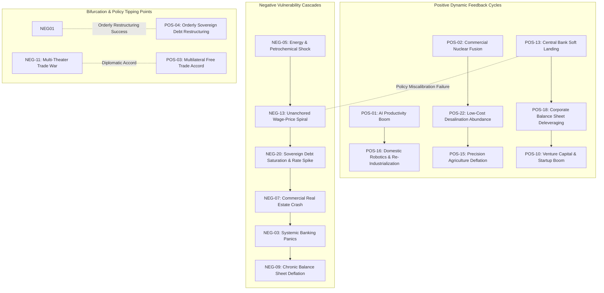

# Macroeconomic Web of Events: Backwards-Planned Causal Architecture

> **Comprehensive Economic Simulation & Game Mechanics Knowledge Base**  
> *50 Major Macroeconomic Events (25 Positive, 25 Negative) with Multi-Tier Backwards-Planned Causal Trees, Impact Scoring, and Graph Linkages.*

---

## 1. Executive Summary & Architecture Overview

In complex macroeconomic systems and central banking simulation environments, major economic events never occur in a vacuum. Instead, they are the culmination of multi-layered, interdependent structural pre-conditions, policy shifts, technological inflections, and market behavioral feedback loops.

This document establishes a **backwards-planned causal web** spanning **50 major economic event types**:
- **25 Positive Macroeconomic Events** (Productivity booms, structural disinflation, energy abundance, financial deep-tech)
- **25 Negative Macroeconomic Events** (Sovereign default cascades, hyperinflation, cyber warfare, bank runs, supply embargoes)
- **253 Level-1 Contributing Factors** (Direct causal drivers and proximate precursors: 5 to 8 per event)
- **508 Level-2 Sub-Contributing Factors** (Foundational microeconomic triggers, institutional shifts, and technical catalysts: 2 to 3 per contributing factor)
- **811 Total Graph Nodes** and **761 Directed Causal Edges**

### Impact Scoring Methodology (0–100 Scale)
Every event is assigned an empirical impact range reflecting its systemic magnitude, volatility transmission potential, and structural alteration of macroeconomic trajectory:

| Impact Tier | Range (0-100) | Economic Definition & Scope | Typical Examples |
|:---|:---:|:---|:---|
| **Minor** | **10 – 30** | Localized sector adjustments; temporary quarterly GDP shifts of 0.2–0.5%; low systemic spillover. | Digital interbank micro-payments adoption, retail surcharge rationalization. |
| **Moderate** | **31 – 60** | Broad multi-sector adjustments; cyclical GDP impact of 1.0–3.0%; shifts in fiscal balances or terms of trade. | Base-broadening tax reform, sovereign debt restructuring, startup VC boom. |
| **Major** | **61 – 80** | Economy-wide structural regime change; GDP shifts of 3.0–6.0%; multi-year balance sheet reorganizations. | Central bank soft landing, trade war escalation, housing bubble burst, CRE crisis. |
| **Transformative** | **81 – 100** | Generational paradigm shifts or existential systemic crises; GDP swings >6.0%; re-anchoring of money, energy, or institutions. | General-Purpose AI boom, commercial fusion, hyperinflation, sovereign debt cascades. |

---

## 2. Master Catalog of 50 Macroeconomic Events

### 2.1 Positive Economic Events (POS-01 to POS-25)

| ID | Event Name | Category | Impact Range | Impact Tier | Direct Factors (L1) | Sub-Factors (L2) |
|:---|:---|:---|:---:|:---:|:---:|:---:|
| **POS-01** | General-Purpose AI Productivity Boom | Technology & Productivity | `85 - 98` | Transformative | 6 | 14 |
| **POS-02** | Commercial Nuclear Fusion & Abundant Clean Energy | Energy & Natural Resources | `85 - 100` | Transformative | 6 | 12 |
| **POS-03** | Comprehensive Multilateral Free Trade Accord | Trade & Geopolitics | `65 - 80` | Major | 5 | 10 |
| **POS-04** | Orderly Sovereign Debt Restructuring & Deleveraging | Fiscal Policy & Sovereign Debt | `45 - 65` | Moderate | 5 | 10 |
| **POS-05** | Smart Grid Modernization & Nationwide Ultra-Fast Fiber Backbone | Infrastructure & Capital Formation | `50 - 70` | Moderate | 5 | 10 |
| **POS-06** | Biomedical Longevity & Autonomous Healthcare Diagnostics Breakthrough | Healthcare & Demographics | `75 - 90` | Major | 5 | 10 |
| **POS-07** | Domestic Energy Self-Sufficiency & Strategic Transition | Energy & Macroeconomics | `70 - 85` | Major | 5 | 10 |
| **POS-08** | Counter-Cyclical Green & Resilient Infrastructure Investment Surge | Fiscal Policy & Fixed Capital | `45 - 65` | Moderate | 5 | 10 |
| **POS-09** | Non-Inflationary Real Wage Growth Expansion | Labor Markets & Consumption | `40 - 60` | Moderate | 5 | 10 |
| **POS-10** | High-Tech Startup Entrepreneurship & Venture Capital Boom | Innovation & Financial Capital | `45 - 65` | Moderate | 5 | 10 |
| **POS-11** | Comprehensive Base-Broadening Tax Simplification Reform | Fiscal Policy & Economic Efficiency | `35 - 55` | Moderate | 5 | 10 |
| **POS-12** | Critical Strategic Mineral & Commodity Export Windfall | Commodities & Trade | `40 - 60` | Moderate | 5 | 10 |
| **POS-13** | Central Bank Flawless Disinflationary Soft Landing | Monetary Policy & Macroeconomic Stability | `60 - 75` | Major | 5 | 10 |
| **POS-14** | High-Skilled Labor Immigration & Human Capital Influx | Labor & Demographics | `45 - 65` | Moderate | 5 | 10 |
| **POS-15** | Precision Agriculture Revolution & Food Price Deflation | Agriculture & Living Costs | `35 - 55` | Moderate | 5 | 10 |
| **POS-16** | Advanced Domestic Robotics & Re-Industrialization Renaissance | Industrial & Supply Chain | `65 - 80` | Major | 5 | 10 |
| **POS-17** | Universal Digital Banking & Instant Interbank Settlement Adoption | Financial Technology & Payment Systems | `30 - 50` | Minor-to-Moderate | 5 | 10 |
| **POS-18** | Broad-Based Corporate Balance Sheet Deleveraging & Solvency Surge | Corporate Finance & Capital Markets | `40 - 60` | Moderate | 5 | 10 |
| **POS-19** | Radical Zoning Deregulation & Affordable Housing Construction Surge | Real Estate & Urban Economics | `55 - 75` | Major | 5 | 10 |
| **POS-20** | Global Multimodal Logistics Automation & Frictionless Port Clearance | Logistics & International Trade | `45 - 65` | Moderate | 5 | 10 |
| **POS-21** | Sovereign Wealth Fund Natural Resource Endowment Capitalization | Sovereign Wealth & Public Assets | `35 - 55` | Moderate | 5 | 10 |
| **POS-22** | Scaled Low-Cost Desalination & Industrial Water Abundance | Natural Resources & Utilities | `60 - 80` | Major | 5 | 10 |
| **POS-23** | Nationwide STEM Technical Apprenticeship & Vocational Upskilling Surge | Human Capital & Education | `55 - 75` | Major | 5 | 10 |
| **POS-24** | Currency Stabilization & Premier Safe-Haven Capital Inflows | Foreign Exchange & External Sector | `40 - 60` | Moderate | 5 | 10 |
| **POS-25** | Distributed Grid Microgeneration & Solid-State Storage Parity | Energy & Decentralized Infrastructure | `65 - 85` | Major | 5 | 10 |

### 2.2 Negative Economic Events (NEG-01 to NEG-25)

| ID | Event Name | Category | Impact Range | Impact Tier | Direct Factors (L1) | Sub-Factors (L2) |
|:---|:---|:---|:---:|:---:|:---:|:---:|
| **NEG-01** | Global Sovereign Debt Default Cascades & Bond Market Fracture | Sovereign Debt & Global Finance | `85 - 100` | Transformative | 6 | 12 |
| **NEG-02** | Runaway Hyperinflationary Currency Collapse | Monetary Policy & Currency Stability | `85 - 98` | Transformative | 5 | 10 |
| **NEG-03** | Systemic Banking Panics, Contagious Bank Runs & Interbank Freeze | Banking & Financial Stability | `80 - 95` | Transformative | 5 | 10 |
| **NEG-04** | Global Semiconductor & Critical Lithography Supply Embargo | Technology & Supply Chain | `75 - 90` | Major | 5 | 10 |
| **NEG-05** | Severe Stagflationary Energy & Petrochemical Price Shock | Energy & Macroeconomics | `70 - 85` | Major | 5 | 10 |
| **NEG-06** | Sovereign Credit Rating Downgrade to Speculative / Junk Status | Sovereign Credit & Spreads | `50 - 70` | Moderate-to-Major | 5 | 10 |
| **NEG-07** | Commercial Real Estate (CRE) Debt Maturity Cliff & Fire Sale Crash | Real Estate & Financial Intermediation | `65 - 80` | Major | 5 | 10 |
| **NEG-08** | Systemic Cyberattack on Wholesale Payment Systems & Energy Grid | Critical Infrastructure & Cybersecurity | `75 - 92` | Major-to-Transformative | 5 | 10 |
| **NEG-09** | Chronic Balance Sheet Deflationary Spiral & Liquidity Trap | Macroeconomic Stagnation & Monetary Policy | `75 - 90` | Major | 5 | 10 |
| **NEG-10** | Severe Multi-Year Continental Crop Failure & Food Crisis | Agriculture & Human Security | `55 - 75` | Major | 5 | 10 |
| **NEG-11** | Full-Scale Multi-Theater Trade War & Retaliatory Tariff Escalation | International Trade & Protectionism | `60 - 80` | Major | 5 | 10 |
| **NEG-12** | Critical Energy Transition Mineral Cartelization & Export Embargo | Critical Minerals & Supply Shock | `50 - 70` | Moderate-to-Major | 5 | 10 |
| **NEG-13** | Unanchored Wage-Price Spiral & Inflationary Psychology Entrenchment | Labor Economics & Inflation | `65 - 82` | Major | 5 | 10 |
| **NEG-14** | Sudden Stop Capital Flight & Severe Currency Depreciation Crisis | External Balance & Balance of Payments | `70 - 88` | Major | 5 | 10 |
| **NEG-15** | Severe Demographic Inversion & Working-Age Population Contraction | Demographics & Labor Economics | `60 - 80` | Major | 5 | 10 |
| **NEG-16** | High-Yield Corporate Debt Market Freeze & Cascade Default Wave | Corporate Credit & Financial Markets | `65 - 82` | Major | 5 | 10 |
| **NEG-17** | Strategic Maritime Chokepoint Blockade & Global Freight Disruption | Maritime Trade & Global Logistics | `50 - 70` | Moderate-to-Major | 5 | 10 |
| **NEG-18** | Sovereign Pension System Insolvency & Mandatory Fiscal Bailout | Public Finance & Entitlements | `60 - 78` | Major | 5 | 10 |
| **NEG-19** | Massive Domestic Brain Drain & High-Skilled Capital Flight | Human Capital & Innovation | `40 - 60` | Moderate | 5 | 10 |
| **NEG-20** | Sovereign Treasury Bond Auction Failure & Debt Saturation Spike | Sovereign Debt & Primary Dealers | `75 - 92` | Major-to-Transformative | 5 | 10 |
| **NEG-21** | Residential Housing Market Bubble Burst & Negative Equity Foreclosures | Residential Real Estate & Household Wealth | `70 - 86` | Major | 5 | 10 |
| **NEG-22** | Shadow Banking / Non-Bank Financial Intermediation (NBFI) Liquidity Run | Shadow Banking & Systemic Risk | `68 - 84` | Major | 5 | 10 |
| **NEG-23** | Severe Institutional Decay, Regulatory Capture & Rule of Law Erosion | Governance & Institutional Capital | `45 - 65` | Moderate-to-Major | 5 | 10 |
| **NEG-24** | Groundwater Depletion & Severe Industrial Drought Collapse | Natural Capital & Water Security | `70 - 90` | Major | 5 | 10 |
| **NEG-25** | Comprehensive Geopolitical Sanctions, Financial Blacklisting & Asset Freezes | Geopolitics & Capital Controls | `75 - 95` | Major-to-Transformative | 5 | 10 |

---

## 3. Detailed Backwards-Planned Causal Web

This section presents the complete backwards-planned causal architecture. For each major event, the causal tree maps backward from the macro outcome down to its **Level-1 Contributing Factors** (proximate drivers), and further backward into **Level-2 Sub-Contributing Factors** (foundational micro-conditions and triggers).

### PART I: POSITIVE ECONOMIC EVENTS

### POS-01: General-Purpose AI Productivity Boom

- **Polarity:** `Positive`
- **Category:** `Technology & Productivity`
- **Impact Score Range:** `85 – 98` / 100 (**Transformative Tier**)
- **Event Summary:** Rapid enterprise adoption and integration of autonomous multi-modal and agentic AI systems across industrial, administrative, and creative workflows, driving an unprecedented surge in Total Factor Productivity (TFP) without triggering destabilizing structural unemployment.

#### Backwards-Planned Causal Tree:

**Factor 1 [POS-01-CF1]: Inference Cost Collapse & Algorithmic Efficiency**
> *Causal Mechanism:* Exponential reduction in compute and energy costs per token allows businesses of all scales to embed cognitive automation into daily operations profitably.

  - **POS-01-CF1-SF1 (Advanced Post-Training Quantization & Sparse Attention):** Mathematical breakthroughs reducing floating-point memory footprint and compute FLOPs by over 80% without losing reasoning fidelity.
  - **POS-01-CF1-SF2 (Sub-2nm Semiconductor Fabrication Scaling):** Mass commercial production of specialized neuromorphic and high-bandwidth-memory accelerators lowering hardware CapEx.
  - **POS-01-CF1-SF3 (Open-Source Foundation Model Parity):** Proliferation of open-weight frontier models eliminating monopoly licensing rents for small and medium enterprises.

**Factor 2 [POS-01-CF2]: Autonomous Agent Orchestration in White-Collar Workflows**
> *Causal Mechanism:* Transition from conversational chatbots to self-correcting agent swarms that execute multi-step operational tasks, collapsing service delivery cycles.

  - **POS-01-CF2-SF1 (Deterministic API Tool-Use Protocols):** Standardized middleware connecting generative neural models directly to enterprise ERP, CRM, and legal databases.
  - **POS-01-CF2-SF2 (Self-Correction & Formal Verification Feedback Loops):** Automated code synthesis and mathematical verification pipelines that minimize hallucination rates below human baseline.

**Factor 3 [POS-01-CF3]: Workforce Augmentation & Rapid Organizational Redesign**
> *Causal Mechanism:* Corporations successfully restructure organizational hierarchy around human-AI hybrid teams, amplifying per-worker output rather than simply cutting headcount.

  - **POS-01-CF3-SF1 (Enterprise AI Literacy & Continuous Reskilling Programs):** Subsidized corporate learning curricula that train knowledge workers in prompt engineering, context curation, and model oversight.
  - **POS-01-CF3-SF2 (Decentralized Flat Management Structures):** Elimination of redundant bureaucratic coordination layers as automated workflows report directly to strategic project leaders.

**Factor 4 [POS-01-CF4]: Accelerated Scientific Discovery & R&D Velocity**
> *Causal Mechanism:* AI-driven materials science, drug design, and genomic mapping compress decade-long laboratory cycles into months, unlocking new patent pipelines.

  - **POS-01-CF4-SF1 (Molecular Simulation & Protein Folding Engines):** Predictive biological modeling identifying viable pharmaceutical candidates and chemical catalysts in silico.
  - **POS-01-CF4-SF2 (Automated High-Throughput Robotic Wet Labs):** Autonomous experimental laboratories operating 24/7 guided by Bayesian optimization algorithms.
  - **POS-01-CF4-SF3 (Cross-Disciplinary Scientific Literature Synthesis):** Machine-extracted hypotheses across millions of academic papers uncovering latent technological linkages.

**Factor 5 [POS-01-CF5]: Industrial Robotics & Physical World Automation**
> *Causal Mechanism:* Integration of vision-language-action (VLA) models into factory, warehouse, and logistics hardware lowers physical manufacturing unit costs.

  - **POS-01-CF5-SF1 (General-Purpose Bipedal & Quadrupedal Manipulators):** Drop-in robotic labor capable of navigating brownfield factories and handling irregular payloads.
  - **POS-01-CF5-SF2 (Zero-Shot Sim-to-Real Transfer Dynamics):** Physics simulation engines training robotic motor control policies in virtual worlds prior to physical deployment.

**Factor 6 [POS-01-CF6]: Clear Regulatory & Intellectual Property Safe Harbors**
> *Causal Mechanism:* Legal certainty regarding data rights, model liability, and fair use eliminates litigation risks that deter large-scale enterprise investment.

  - **POS-01-CF6-SF1 (Harmonized Global AI Copyright Frameworks):** Clear statutory royalty mechanisms for training corpora and safe harbor exemptions for non-infringing derivative generation.
  - **POS-01-CF6-SF2 (Streamlined Model Safety Certification Standards):** Objective compliance benchmarks administered by commercial testing bodies preventing bureaucratic regulatory capture.

---

### POS-02: Commercial Nuclear Fusion & Abundant Clean Energy

- **Polarity:** `Positive`
- **Category:** `Energy & Natural Resources`
- **Impact Score Range:** `85 – 100` / 100 (**Transformative Tier**)
- **Event Summary:** Successful commissioning and commercial grid integration of magnetically or inertially confined nuclear fusion reactors, delivering virtually limitless, zero-carbon, baseload electricity at near-zero marginal cost.

#### Backwards-Planned Causal Tree:

**Factor 1 [POS-02-CF1]: High-Temperature Superconducting (HTS) Magnet Breakthroughs**
> *Causal Mechanism:* Rare-earth barium copper oxide (REBCO) magnet tapes generate magnetic field densities exceeding 20 Tesla, enabling compact, cost-effective tokamak confinement.

  - **POS-02-CF1-SF1 (Industrial REBCO Tape Manufacturing Scale):** Continuous vapor deposition techniques slashing per-meter superconducting tape production costs by an order of magnitude.
  - **POS-02-CF1-SF2 (Cryogenic Sub-Cooling Thermal Management):** Closed-loop liquid nitrogen/helium refrigeration plants maintaining stability under extreme neutron flux.

**Factor 2 [POS-02-CF2]: Net Energy Gain (Q > 10) Sustained Plasma Control**
> *Causal Mechanism:* Continuous magnetic confinement maintaining steady-state burning plasma without catastrophic magnetohydrodynamic disruptions.

  - **POS-02-CF2-SF1 (Deep Reinforcement Learning Magnetic Actuation):** Microsecond-scale coil adjustments predicting and suppressing tearing modes and edge-localized plasma instabilities.
  - **POS-02-CF2-SF2 (Advanced Pellet Injection Fueling Systems):** Cryogenic deuterium-tritium ice pellet guns maintaining core plasma density profiles without cooling boundaries.

**Factor 3 [POS-02-CF3]: Tritium Self-Sufficiency & Breeding Blankets**
> *Causal Mechanism:* Engineered lithium-bearing blankets achieve a tritium breeding ratio (TBR) > 1.15, closing the nuclear fuel cycle and removing external fuel bottlenecks.

  - **POS-02-CF3-SF1 (Liquid Metal Lithium-Lead Eutectic Blankets):** High-heat-capacity molten alloys combining neutron multiplication, tritium capture, and primary heat exchange.
  - **POS-02-CF3-SF2 (In-Line Continuous Isotope Separation):** Permeation membranes and cryogenic distillation extracting tritium from coolant streams with near-zero leakage.

**Factor 4 [POS-02-CF4]: Radiation-Tolerant First-Wall Metallurgy**
> *Causal Mechanism:* Novel structural materials resist embrittlement and swelling under 14 MeV neutron irradiation, ensuring multi-year plant operational lifespans.

  - **POS-02-CF4-SF1 (Reduced-Activation Ferritic/Martensitic (RAFM) Steels):** Engineered alloys replacing cobalt and nickel with tungsten and tantalum to avoid long-lived transuranic isotopes.
  - **POS-02-CF4-SF2 (Silicon Carbide Ceramic Matrix Composites (SiC/SiC)):** High-temperature refractory cladding surviving extreme plasma heat exhaust in the divertor region.

**Factor 5 [POS-02-CF5]: De-Risked Nuclear Regulatory Licensing Regime**
> *Causal Mechanism:* Governments categorize fusion under particle-accelerator or non-fission regulatory frameworks, bypassing decades-long fission licensing delays.

  - **POS-02-CF5-SF1 (Absence of Meltdown / Proliferation Hazard Recognition):** Statutory determinations that fusion physics inherently prevents runaway criticality or weapon-grade fissile material creation.
  - **POS-02-CF5-SF2 (Standardized Modular Pilot Plant Approvals):** Streamlined environmental permitting allowing commercial demonstration facilities on decommissioned coal plant sites.

**Factor 6 [POS-02-CF6]: Private-Public Capital Convergence**
> *Causal Mechanism:* Over $50B in blended sovereign guarantees and deep venture capital deploy into pilot plants with guaranteed grid off-take contracts.

  - **POS-02-CF6-SF1 (Milestone-Based Milestone Government Match Grants):** Public matching of private capital tied strictly to verifiable Q-factor and magnetic confinement duration benchmarks.
  - **POS-02-CF6-SF2 (Long-Term Industrial Power Purchase Agreements (PPAs)):** Data centers, aluminum smelters, and green hydrogen hubs signing 20-year advance purchase agreements.

---

### POS-03: Comprehensive Multilateral Free Trade Accord

- **Polarity:** `Positive`
- **Category:** `Trade & Geopolitics`
- **Impact Score Range:** `65 – 80` / 100 (**Major Tier**)
- **Event Summary:** Signing and ratification of an expansive multilateral trade treaty among major economic blocs, slashing tariffs, harmonizing digital standards, and removing non-tariff barriers to supercharge cross-border commerce.

#### Backwards-Planned Causal Tree:

**Factor 1 [POS-03-CF1]: Geopolitical De-escalation & Diplomatic Convergence**
> *Causal Mechanism:* Strategic recognition among trading powers that economic decoupling imposes unsustainable deadweight losses on domestic consumers.

  - **POS-03-CF1-SF1 (Bilateral Summit Confidence-Building Treaties):** High-level bilateral negotiations establishing mutual non-aggression protocols and verified export compliance checks.
  - **POS-03-CF1-SF2 (De-politicization of Commercial Supply Chains):** Carving out essential consumer goods, green technologies, and agricultural products from national security sanctions.

**Factor 2 [POS-03-CF2]: Universal Tariff Elimination on Manufactured & Agrifood Goods**
> *Causal Mechanism:* Phased reduction of import duties to 0% across 95% of tariff lines, restoring comparative advantage and lowering import price indexes.

  - **POS-03-CF2-SF1 (Reciprocal Most-Favored-Nation (MFN) Schedules):** Binding legal commitments locking in low import tariffs backed by an independent multilateral dispute tribunal.
  - **POS-03-CF2-SF2 (Agricultural Subsidy Rationalization Mechanisms):** Equitable caps on production-distorting farm price supports paired with transition adjustment assistance.

**Factor 3 [POS-03-CF3]: Harmonization of Technical Standards & Regulatory Mutual Recognition**
> *Causal Mechanism:* Mutual recognition of conformity assessments eliminates redundant product safety certifications and border inspections.

  - **POS-03-CF3-SF1 (Unified Phytosanitary & Industrial Quality Protocols):** Adoption of shared scientific criteria for food safety, electronics testing, and medical device approvals.
  - **POS-03-CF3-SF2 (Single-Window Digital Customs Declarations):** Interoperable national customs platforms validating bills of lading and origin certificates within minutes.

**Factor 4 [POS-03-CF4]: Digital Trade & Cross-Border Data Flow Guarantees**
> *Causal Mechanism:* Prohibitions on digital customs duties and localization mandates allow cloud services, fintech, and digital media to scale globally.

  - **POS-03-CF4-SF1 (Enforceable Cross-Border Privacy & Encryption Accords):** Legal mechanisms permitting compliant transmission of corporate and consumer data without local server mandates.
  - **POS-03-CF4-SF2 (Mutual Recognition of Electronic Contracts & Signatures):** International legal enforceability of smart contracts and digital signatures in mercantile commercial law.

**Factor 5 [POS-03-CF5]: Robust Independent Dispute Settlement Architecture**
> *Causal Mechanism:* A fast-track arbitration mechanism with teeth prevents unilateral retaliatory tariff spirals when trade disputes arise.

  - **POS-03-CF5-SF1 (Permanent Appellate Body with Enforceable Rulings):** Depoliticized judicial appointments with authority to authorize compensatory tariff adjustments against non-compliant states.
  - **POS-03-CF5-SF2 (Investor-State Mediation Transparency Rules):** Public arbitration procedures balancing foreign investor protections with sovereign domestic public-health policy space.

---

### POS-04: Orderly Sovereign Debt Restructuring & Deleveraging

- **Polarity:** `Positive`
- **Category:** `Fiscal Policy & Sovereign Debt`
- **Impact Score Range:** `45 – 65` / 100 (**Moderate Tier**)
- **Event Summary:** Coordinated international and domestic sovereign debt restructuring that reprofiles maturities, lowers interest burdens, and restores fiscal sustainability without triggering financial market contagion or sovereign default stigmas.

#### Backwards-Planned Causal Tree:

**Factor 1 [POS-04-CF1]: Multilateral Creditor Consensus (Paris Club & Private Bondholders)**
> *Causal Mechanism:* Unified creditor frameworks ensure equitable burden sharing between bilateral sovereign lenders and commercial asset managers.

  - **POS-04-CF1-SF1 (Collective Action Clauses (CACs) with High Participation):** Single-limb cross-series voting thresholds preventing holdout vulture funds from blocking restructuring agreements.
  - **POS-04-CF1-SF2 (Equal Comparability of Treatment Protocols):** Enforceable rules ensuring non-Paris Club bilateral creditors accept net present value (NPV) reductions equal to private bondholders.

**Factor 2 [POS-04-CF2]: Debt-for-Growth & Climate Resilience Swaps**
> *Causal Mechanism:* Replacing high-interest legacy bonds with performance-linked green or growth bonds whose debt service varies with macroeconomic performance.

  - **POS-04-CF2-SF1 (State-Contingent Debt Instruments (SCDIs)):** Bonds featuring automatic coupon step-downs or maturity extensions if GDP growth falls below preset thresholds or natural disasters strike.
  - **POS-04-CF2-SF2 (Sovereign Blue/Green Refinancing Facilities):** Multilateral development bank partial guarantees reducing refinancing yield spreads on newly issued sustainable sovereign bonds.

**Factor 3 [POS-04-CF3]: Credible Medium-Term Fiscal Consolidation Framework**
> *Causal Mechanism:* Sovereign commits to binding primary balance targets, eliminating structural deficits while protecting capital investments.

  - **POS-04-CF3-SF1 (Independent Fiscal Council Oversight):** Autonomous non-partisan economic institutions auditing revenue projections and enforcing spending ceilings.
  - **POS-04-CF3-SF2 (Elimination of Regressive Universal Subsidies):** Replacing universal fossil fuel subsidies with targeted biometric cash transfers for vulnerable households.

**Factor 4 [POS-04-CF4]: Extension of Debt Maturity Profiles (Maturity Smoothing)**
> *Causal Mechanism:* Refinancing near-term debt walls into 20-30 year long-dated bonds, extinguishing immediate rollover risk and refinancing cliffs.

  - **POS-04-CF4-SF1 (Liability Management Debt Buybacks):** Opportunistic repurchase of discounted short-term notes using concessional liquidity facilities.
  - **POS-04-CF4-SF2 (Domestic Institutional Investor Anchor Allocations):** Pension funds and sovereign insurers absorbing long-dated sovereign paper matching liability durations.

**Factor 5 [POS-04-CF5]: Restoration of Sovereign Credit Upgrades & Market Access**
> *Causal Mechanism:* Rating agencies lift sovereign credit ratings back to investment grade, unlocking lower borrowing costs for domestic banks and corporations.

  - **POS-04-CF5-SF1 (Primary Surplus Generation):** Sustained revenue outperformance over primary operational expenditures demonstrating solvency.
  - **POS-04-CF5-SF2 (Narrowing Sovereign CDS Spreads):** Secondary market credit default swap premiums shrinking to historical medians, restoring investor appetite.

---

### POS-05: Smart Grid Modernization & Nationwide Ultra-Fast Fiber Backbone

- **Polarity:** `Positive`
- **Category:** `Infrastructure & Capital Formation`
- **Impact Score Range:** `50 – 70` / 100 (**Moderate Tier**)
- **Event Summary:** Comprehensive overhaul of the national electrical transmission grid into an automated, bidirectional smart network coupled with universal multi-gigabit fiber broadband, eliminating logistics bottlenecks and digital divides.

#### Backwards-Planned Causal Tree:

**Factor 1 [POS-05-CF1]: High-Voltage Direct Current (HVDC) Transmission Corridors**
> *Causal Mechanism:* Construction of long-distance HVDC lines transporting remote renewable power from wind/solar hubs to industrial metropolitan centers with sub-3% transmission losses.

  - **POS-05-CF1-SF1 (Streamlined Inter-State Right-of-Way Permitting):** Federal preemption of fragmented local zoning hurdles along designated highway and rail transit easements.
  - **POS-05-CF1-SF2 (Modular Multilevel Converter (MMC) Stations):** Advanced power electronics smoothly interfacing ultra-high-voltage DC lines with localized AC distribution networks.

**Factor 2 [POS-05-CF2]: Bidirectional Smart Metering & Dynamic Demand Response**
> *Causal Mechanism:* Real-time automated pricing signals balance load dynamically, shaving peak electricity demand and deferring costly generation peaker plant builds.

  - **POS-05-CF2-SF1 (IoT-Enabled Smart Thermostats & EV Virtual Power Plants):** Cloud-aggregated residential batteries and HVAC systems flexing power consumption during grid stress.
  - **POS-05-CF2-SF2 (Automated Real-Time Locational Marginal Pricing (LMP)):** Software algorithms publishing granular 5-minute price signals directly to smart consumer appliances.

**Factor 3 [POS-05-CF3]: Universal Rural & Urban Fiber-to-the-Home (FTTH) Rollout**
> *Causal Mechanism:* Ubiquitous gigabit fiber deployment provides equitable access to remote work, telemedicine, e-commerce, and advanced education.

  - **POS-05-CF3-SF1 (Public-Private Broadband Infrastructure Co-Financing):** Reverse auction subsidies directing infrastructure grants to telecom providers delivering dark fiber to unserved tracts.
  - **POS-05-CF3-SF2 (Microtrenching & Dig-Once Municipal Regulations):** Mandatory integration of fiber conduits during municipal road repairs and utility line trenching.

**Factor 4 [POS-05-CF4]: Automated Grid Fault Detection & Self-Healing Architecture**
> *Causal Mechanism:* Synchrophasors and automated reclosers isolate line faults in milliseconds, drastically reducing systemic blackout frequencies and industrial downtime.

  - **POS-05-CF4-SF1 (Phasor Measurement Unit (PMU) Sensor Saturation):** GPS-synchronized high-speed waveform sampling detecting voltage sags and phase shifts before line trips occur.
  - **POS-05-CF4-SF2 (Autonomous Distribution Management Systems (ADMS)):** AI-driven grid software rerouting power around damaged sub-stations without manual lineman intervention.

**Factor 5 [POS-05-CF5]: Utility-Scale Battery Storage Interconnection Reforms**
> *Causal Mechanism:* Accelerated grid connection queues enable gigawatts of battery storage to provide instant frequency regulation and black-start capabilities.

  - **POS-05-CF5-SF1 (Standardized Interconnection Study Protocols):** Replacing sequential bureaucratic review processes with automated cluster-based engineering simulations.
  - **POS-05-CF5-SF2 (Capacity Market Valuation for Rapid-Response Inverters):** Wholesale market rules compensating grid-forming inverter batteries for providing synthetic inertia.

---

### POS-06: Biomedical Longevity & Autonomous Healthcare Diagnostics Breakthrough

- **Polarity:** `Positive`
- **Category:** `Healthcare & Demographics`
- **Impact Score Range:** `75 – 90` / 100 (**Major Tier**)
- **Event Summary:** Breakthrough therapeutic interventions reversing cellular senescence combined with ubiquitous autonomous diagnostic screening, expanding the healthy working lifespan and drastically compressing national healthcare expenditures.

#### Backwards-Planned Causal Tree:

**Factor 1 [POS-06-CF1]: Senolytic & Epigenetic Reprogramming Therapies**
> *Causal Mechanism:* Clearance of senescent cells and partial epigenetic reprogramming reduce chronic age-related degenerative pathologies (cardiovascular, neurodegenerative, metabolic).

  - **POS-06-CF1-SF1 (Targeted Small-Molecule Senolytics):** Selective apoptosis-inducing compounds purging toxic senescent cells from vascular and connective tissues.
  - **POS-06-CF1-SF2 (Transient In Vivo Yamanaka Factor Delivery):** mRNA-based targeted vectors resetting cellular DNA methylation clocks without oncogenic transformation.

**Factor 2 [POS-06-CF2]: Autonomous AI Multi-Modal Pathology & Radiology Diagnostics**
> *Causal Mechanism:* Algorithmic screening of imaging, genomic sequences, and blood biomarkers detects Stage 0 oncology and micro-vascular disease years before symptom onset.

  - **POS-06-CF2-SF1 (Universal Liquid Biopsy Cell-Free DNA (cfDNA) Panels):** Annual low-cost blood tests screening for methylation patterns of over 50 solid organ malignancies.
  - **POS-06-CF2-SF2 (Continuous Continuous Multi-Analyte Wearable Biosensors):** Microneedle dermal patches tracking interstitial metabolites, inflammatory cytokines, and hormonal fluctuations.

**Factor 3 [POS-06-CF3]: Collapse in Medical Administrative Overhead**
> *Causal Mechanism:* Automated medical coding, clinical documentation, and insurance billing eliminate non-clinical bureaucratic costs, reducing overall healthcare spend by 25-35%.

  - **POS-06-CF3-SF1 (Real-Time Interoperable Adjudication Smart Contracts):** Direct point-of-care claims verification eliminating multi-month billing disputes and revenue cycle overhead.
  - **POS-06-CF3-SF2 (Ambient Clinical Ambient Scribes & Care Navigators):** Voice-to-EHR generative transcription eliminating physician burnout and administrative charting hours.

**Factor 4 [POS-06-CF4]: Extension of Productive Working Life & Human Capital Retention**
> *Causal Mechanism:* Seniors maintain physical vitality and cognitive acuity well into their 70s and 80s, stabilizing pension ratios and retaining institutional leadership.

  - **POS-06-CF4-SF1 (Preservation of Fluid Cognitive Executive Function):** Therapeutics preventing tau neurofibrillary tangles and microglial neuroinflammation in aging brains.
  - **POS-06-CF4-SF2 (Sarcopenia & Osteoporosis Reversal):** Myostatin inhibitors and regenerative bone peptide therapies sustaining physical mobility and independence.

**Factor 5 [POS-06-CF5]: mRNA Vaccine Platforms for Infectious Disease & Cancer**
> *Causal Mechanism:* Personalized neoantigen cancer vaccines and broad-spectrum pan-coronavirus/influenza inoculations prevent pandemics and eradicate tumor recurrence.

  - **POS-06-CF5-SF1 (Rapid Antigen Genomic Sequencing & Synthesis):** Automated pipelines manufacturing patient-specific personalized neoantigen mRNA vaccines within 14 days.
  - **POS-06-CF5-SF2 (Lipid Nanoparticle (LNP) Targeted Organ Delivery):** Engineered chemical formulations targeting specific lymph nodes and dendritic cells with minimal reactogenicity.

---

### POS-07: Domestic Energy Self-Sufficiency & Strategic Transition

- **Polarity:** `Positive`
- **Category:** `Energy & Macroeconomics`
- **Impact Score Range:** `70 – 85` / 100 (**Major Tier**)
- **Event Summary:** Attainment of complete net energy independence through diversified domestic renewable generation, strategic hydrocarbon management, and grid-scale storage, insulating the economy from geopolitical petro-shocks.

#### Backwards-Planned Causal Tree:

**Factor 1 [POS-07-CF1]: Mass Deployment of Low-Cost Solar Photovoltaics & Offshore Wind**
> *Causal Mechanism:* Unsubsidized levelized cost of electricity (LCOE) falling below $20/MWh displaces imported fossil fuels from the primary generation stack.

  - **POS-07-CF1-SF1 (Perovskite-Silicon Tandem Solar Cell Commercialization):** Commercial solar panel efficiencies breaching 30% without significant manufacturing cost premiums.
  - **POS-07-CF1-SF2 (15+ Megawatt Floating Offshore Wind Turbines):** Deepwater tension-leg platforms tapping steady ocean gale forces beyond visual coastline horizons.

**Factor 2 [POS-07-CF2]: Electrification of Domestic Transport & Industrial Heat**
> *Causal Mechanism:* Rapid EV fleet penetration and heat pump adoption drastically lowers crude oil consumption and petro-chemical import bills.

  - **POS-07-CF2-SF1 (Sub-$60/kWh Sodium-Ion and LFP Battery Chemistries):** Abundant mineral battery packs bringing electric passenger vehicles below internal combustion cost parity.
  - **POS-07-CF2-SF2 (High-Temperature Industrial Thermal Energy Storage (TES)):** Molten salt and refractory brick thermal batteries providing 1,000°C steam for factories from renewable power.

**Factor 3 [POS-07-CF3]: Strategic Domestic Hydrocarbon Buffer Reservoirs**
> *Causal Mechanism:* Maintaining strategically managed domestic transitional gas supplies ensuring continuous baseload resilience during peak demand anomalies.

  - **POS-07-CF3-SF1 (Depleted Reservoir Underground Gas Storage Systems):** Pressurized geological formations storing months of seasonal reserve volumes for extreme winter contingencies.
  - **POS-07-CF3-SF2 (Automated Methane Leak Detection & Capture Mandates):** Satellite and drone LiDAR monitoring mitigating greenhouse gas leaks from domestic pipeline infrastructure.

**Factor 4 [POS-07-CF4]: Domestic Refining & Critical Refining Infrastructure Resilience**
> *Causal Mechanism:* Upgrading domestic petrochemical cracking and processing facilities ensures that domestic crude can be processed domestically without foreign offshore dependency.

  - **POS-07-CF4-SF1 (Hydrocracker Flexibility Upgrades):** Refinery modifications capable of processing light tight oils and synthetic bio-crudes interchangeably.
  - **POS-07-CF4-SF2 (Hardened Pipeline Telemetry Cyber-Defenses):** Air-gapped operational technology controls insulating pipeline valves from foreign state-sponsored ransomware.

**Factor 5 [POS-07-CF5]: Balance of Payments Insulation & Elimination of Imported Inflation**
> *Causal Mechanism:* Elimination of foreign hydrocarbon import expenditures converts a chronic trade deficit into a durable current account surplus, stabilizing exchange rates.

  - **POS-07-CF5-SF1 (Petrodollar Inflow Diversification):** Reduced foreign currency outflows preserving sovereign central bank foreign exchange reserve buffers.
  - **POS-07-CF5-SF2 (Domestic Electricity Price Decoupling from Global Brent/TTF Quotes):** Separation of wholesale marginal power tariffs from volatile international spot natural gas indices.

---

### POS-08: Counter-Cyclical Green & Resilient Infrastructure Investment Surge

- **Polarity:** `Positive`
- **Category:** `Fiscal Policy & Fixed Capital`
- **Impact Score Range:** `45 – 65` / 100 (**Moderate Tier**)
- **Event Summary:** Targeted, fiscally disciplined sovereign capital expenditure program focusing on climate-resilient water systems, intercity rail corridors, and flood defenses that stimulates aggregate demand while boosting long-term potential GDP.

#### Backwards-Planned Causal Tree:

**Factor 1 [POS-08-CF1]: High-Speed Rail & Intermodal Freight Logistics Corridors**
> *Causal Mechanism:* Modernizing freight and passenger rail networks takes long-haul trucking off highways, cutting logistics costs and reducing fuel emissions.

  - **POS-08-CF1-SF1 (Electrified Mainline Double-Tracking):** Expanding dedicated high-speed freight rail tracks between deepwater ports and inland logistics dry hubs.
  - **POS-08-CF1-SF2 (Automated Railcar Intermodal Transfer Terminals):** Robotic gantry cranes transferring standard shipping containers between trains and autonomous drayage trucks.

**Factor 2 [POS-08-CF2]: Climate Adaptation Flood Barriers & Stormwater Architecture**
> *Causal Mechanism:* Hardening coastal cities and river basins against 100-year flood events protects trillions in vulnerable municipal and private real estate.

  - **POS-08-CF2-SF1 (Tidal Storm Surge Barriers & Floodwalls):** Mechanized sea gates guarding coastal estuaries and maritime ports against extreme meteorological storm surges.
  - **POS-08-CF2-SF2 (Sponge City Permeable Urban Drainage Networks):** Subterranean retention cisterns and bioswales mitigating catastrophic flash-flooding in dense urban downtowns.

**Factor 3 [POS-08-CF3]: National Water Transmission Aqueducts & Treatment Plants**
> *Causal Mechanism:* Inter-basin water transfer networks and modern tertiary wastewater recycling facilities secure municipal and industrial supplies in arid growth regions.

  - **POS-08-CF3-SF1 (Reverse Osmosis Municipal Wastewater Reclamation):** Advanced filtration recycling industrial wastewater directly into groundwater aquifer replenishment.
  - **POS-08-CF3-SF2 (Leak-Proof Pressurized Aqueduct Corridors):** Replacing aging open irrigation canals with sensor-monitored enclosed pipelines eliminating evaporation losses.

**Factor 4 [POS-08-CF4]: Public-Private Partnership (P3) Capital Mobilization**
> *Causal Mechanism:* Structuring private equity and institutional pension co-investment with concession rights and revenue floors multiplies the impact of public tax dollars.

  - **POS-08-CF4-SF1 (Availability Payment Concession Contracts):** Performance-linked government payments compensating private consortia based on asset uptime and safety rather than toll collection risk.
  - **POS-08-CF4-SF2 (National Infrastructure Development Bank Guarantees):** State-backed subordinate debt and first-loss equity tranches de-risking commercial bank syndicated loans.

**Factor 5 [POS-08-CF5]: Rigorous Value-for-Money Auditing & NEPA Permitting Reform**
> *Causal Mechanism:* Streamlining environmental impact reviews and instituting fixed statutory approval timelines prevents cost overruns and multi-year litigation delays.

  - **POS-08-CF5-SF1 (Categorical Exclusions for Clean Infrastructure):** Exempting zero-emission transit, power lines, and renewable projects from redundant environmental impact statements.
  - **POS-08-CF5-SF2 (One-In, One-Out Permitting Coordination Bureaus):** A single lead federal agency managing multi-agency statutory signoffs under an enforceable 12-month clock.

---

### POS-09: Non-Inflationary Real Wage Growth Expansion

- **Polarity:** `Positive`
- **Category:** `Labor Markets & Consumption`
- **Impact Score Range:** `40 – 60` / 100 (**Moderate Tier**)
- **Event Summary:** Broad-based growth in household purchasing power where real wages rise steadily in tandem with underlying labor productivity, expanding consumption without stoking wage-push inflation spirals.

#### Backwards-Planned Causal Tree:

**Factor 1 [POS-09-CF1]: High Underlying Labor Productivity Growth**
> *Causal Mechanism:* Workers produce more output per hour worked via technological enablement, allowing firms to raise compensation without expanding unit labor costs (ULC).

  - **POS-09-CF1-SF1 (Enterprise Capital Deepening):** Corporate investment in advanced machinery, software, and robotics increasing the capital-to-labor ratio.
  - **POS-09-CF1-SF2 (Managerial Process Optimizations):** Elimination of workflow inefficiencies through agile management methodologies and digitized scheduling.

**Factor 2 [POS-09-CF2]: Robust Collective Bargaining & Worker Mobility**
> *Causal Mechanism:* Transparent labor market matching and portable employee benefits empower workers to capture their equitable marginal revenue product of labor.

  - **POS-09-CF2-SF1 (Banning of Non-Compete Clauses):** Statutory elimination of restrictive covenants allowing employees to freely transition to higher-paying competitors.
  - **POS-09-CF2-SF2 (Mandatory Pay Transparency Legislation):** Public posting of salary bands in job requisitions reducing wage dispersion and employer monopsony leverage.

**Factor 3 [POS-09-CF3]: Expansion of Worker Ownership & Profit-Sharing Schemes**
> *Causal Mechanism:* Broad adoption of Employee Stock Ownership Plans (ESOPs) and performance profit-sharing links household income to corporate equity appreciation.

  - **POS-09-CF3-SF1 (Tax Incentives for Broad-Based Stock Distribution):** Preferential corporate tax treatment for firms granting equity ownership to non-executive frontline staff.
  - **POS-09-CF3-SF2 (Worker Representative Board Governance):** Codetermination frameworks aligning corporate reinvestment and dividend policy with worker welfare.

**Factor 4 [POS-09-CF4]: Stable Core Inflation & Disinflationary Commodity Trends**
> *Causal Mechanism:* Stable prices for non-discretionary expenses (groceries, energy, telecoms) ensure that nominal wage increases translate 1-to-1 into real spending power.

  - **POS-09-CF4-SF1 (Competitive Domestic Retail Market Structures):** Strict antitrust enforcement against grocery and consumer goods retail price-fixing cartels.
  - **POS-09-CF4-SF2 (Anchored Medium-Term Inflation Expectations):** Central bank inflation targets firmly credible among households, preventing preemptive price markups.

**Factor 5 [POS-09-CF5]: Decline in Household Debt Service Ratios**
> *Causal Mechanism:* Low borrowing costs and stable consumer credit terms leave a larger share of disposable income available for discretionary consumption and savings.

  - **POS-09-CF5-SF1 (Consumer Credit Rate Caps & Fair Lending Rules):** Usury guardrails preventing predatory credit card interest rates from eroding lower-income earnings.
  - **POS-09-CF5-SF2 (Mortgage Refinancing Liquidity Windows):** Frictionless title transfer and mortgage refinancing options locking in lower long-term monthly payments.

---

### POS-10: High-Tech Startup Entrepreneurship & Venture Capital Boom

- **Polarity:** `Positive`
- **Category:** `Innovation & Financial Capital`
- **Impact Score Range:** `45 – 65` / 100 (**Moderate Tier**)
- **Event Summary:** Vibrant surge in new business formation, university technology spinouts, and seed-stage venture financing that accelerates creative destruction and transforms laboratory breakthroughs into commercial engines.

#### Backwards-Planned Causal Tree:

**Factor 1 [POS-10-CF1]: Abundant Early-Stage Seed & Angel Capital Availability**
> *Causal Mechanism:* Active angel networks and micro-VC funds provide accessible runway for proof-of-concept prototyping, de-risking technology startups.

  - **POS-10-CF1-SF1 (Capital Gains Tax Exemptions for Qualified Small Business Stock (QSBS)):** 100% federal capital gains tax exclusion on early equity held in qualifying high-tech start-ups for over five years.
  - **POS-10-CF1-SF2 (Democratized Equity Crowdfunding Thresholds):** Expanded Reg CF caps permitting retail investors to participate in vetted seed funding rounds.

**Factor 2 [POS-10-CF2]: University Tech Transfer & IP Commercialization Streamlining**
> *Causal Mechanism:* Academic institutions adopt standard, non-exclusive IP licensing templates, empowering researchers to spin out deep-tech ventures in weeks.

  - **POS-10-CF2-SF1 (Standardized 5% University Royalty Equity Caps):** Capping institutional equity stakes to preserve sufficient founder equity for future venture capital dilution.
  - **POS-10-CF2-SF2 (Dual-Appointment Faculty Entrepreneur Policies):** Clear leave-of-absence policies allowing university scientists to act as founding CEOs while retaining tenure.

**Factor 3 [POS-10-CF3]: Frictionless Corporate Registration & Digital Legal Infrastructure**
> *Causal Mechanism:* Zero-friction digital business registration, standardized SAFE notes, and automated regulatory filings minimize initial legal burn rates.

  - **POS-10-CF3-SF1 (One-Hour Online Incorporation & EIN Issuance):** Integrated government portals issuing corporate charters, tax IDs, and bank links simultaneously.
  - **POS-10-CF3-SF2 (Standardized Open-Source Financing Instruments):** Universal legal acceptance of Simple Agreements for Future Equity (SAFE) and convertible notes.

**Factor 4 [POS-10-CF4]: Cluster Densification & Co-Location Ecosystems**
> *Causal Mechanism:* Concentrations of engineering talent, incubators, prototyping labs, and specialized legal services create powerful local agglomeration spillovers.

  - **POS-10-CF4-SF1 (Subsidized Deep-Tech Prototyping Cleanrooms & Makerspaces):** Shared access to million-dollar lithography, 3D printing, and wet-lab equipment for early-stage teams.
  - **POS-10-CF4-SF2 (Informal Knowledge Spillover Meetups & Hackathons):** Dense urban tech hubs fostering continuous cross-pollination between domain experts and software engineers.

**Factor 5 [POS-10-CF5]: Vibrant Initial Public Offering (IPO) & M&A Exit Markets**
> *Causal Mechanism:* Liquid secondary and public markets allow venture capital funds to return capital to limited partners, renewing the funding flywheel.

  - **POS-10-CF5-SF1 (Streamlined Small-Cap Public Listing Frameworks):** Proportional disclosure rules for emerging growth companies lowering underwriting fees and audit costs.
  - **POS-10-CF5-SF2 (Pro-Competitive Acquisition Review Safe Harbors):** Antitrust guidelines permitting large tech firms to acquire early-stage pre-revenue startups while preventing anticompetitive killer acquisitions.

---

### POS-11: Comprehensive Base-Broadening Tax Simplification Reform

- **Polarity:** `Positive`
- **Category:** `Fiscal Policy & Economic Efficiency`
- **Impact Score Range:** `35 – 55` / 100 (**Moderate Tier**)
- **Event Summary:** Legislative overhaul of the tax code that eliminates distortionary loopholes, special-interest deductions, and compliance burdens while flattening marginal rates to encourage productive work and capital formation.

#### Backwards-Planned Causal Tree:

**Factor 1 [POS-11-CF1]: Full Immediate Expensing (100% Bonus Depreciation)**
> *Causal Mechanism:* Allowing businesses to deduct capital investments in machinery, software, and R&D in year one stimulates fixed capital formation and modernization.

  - **POS-11-CF1-SF1 (Permanent Section 179 Expensing Caps):** Statutory guarantees that immediate write-offs for capital purchases will not sunset across fiscal years.
  - **POS-11-CF1-SF2 (Immediate Deduction of Software & Laboratory R&D Costs):** Reversal of amortization mandates, letting engineering payroll be written off against current-year revenues.

**Factor 2 [POS-11-CF2]: Elimination of Special-Interest Loopholes & Carve-Outs**
> *Causal Mechanism:* Closing bespoke tax shelters and industry-specific write-offs broadens the taxable base, enabling lower headline corporate rates without loss of revenue.

  - **POS-11-CF2-SF1 (Repeal of Fossil Fuel Depletion Allowances):** Ending legacy preferential tax treatments for mature extractive industries.
  - **POS-11-CF2-SF2 (Closure of Carried Interest & Stepped-Up Basis Gaps):** Treating private equity performance fees as ordinary income and ending generational untaxed capital gain transfers.

**Factor 3 [POS-11-CF3]: Radical Simplification of Individual Income Tax Filings**
> *Causal Mechanism:* Automatic pre-populated tax returns and consolidated standard deductions slash hundreds of millions of hours in wasted compliance overhead.

  - **POS-11-CF3-SF1 (Return-Free Filing for W-2 Wage Earners):** Government revenue agencies calculating returns based on automated W-2 and 1099 bank data feeds.
  - **POS-11-CF3-SF2 (Consolidation of Fragmented Family Credits into a Single Child Benefit):** Merging child tax credits, dependent care deductions, and earned income credits into an automated monthly benefit.

**Factor 4 [POS-11-CF4]: Destination-Based Border-Neutral Sales & Value-Added Structuring**
> *Causal Mechanism:* Aligning consumption taxes on a territorial basis neutralizes transfer-pricing profit shifting to offshore tax havens.

  - **POS-11-CF4-SF1 (OECD Pillar Two Global Minimum Tax Implementation):** 15% effective global minimum corporate tax rate ending the international 'race to the bottom'.
  - **POS-11-CF4-SF2 (Economic Nexus Sales Tax Harmonization):** Streamlined collection of state and municipal sales taxes across e-commerce platforms without micro-jurisdiction paperwork.

**Factor 5 [POS-11-CF5]: Neutral Treatment of Debt vs. Equity Financing**
> *Causal Mechanism:* Capping corporate interest expense deductibility removes the artificial tax bias toward excessive corporate debt leverage.

  - **POS-11-CF5-SF1 (EBITDA-Based Interest Deduction Limits):** Limiting deductible interest payments to 30% of earnings before interest, taxes, depreciation, and amortization.
  - **POS-11-CF5-SF2 (Allowance for Corporate Equity (ACE) Deductions):** Granting a notional deduction for newly issued retained earnings equity, balancing incentives.

---

### POS-12: Critical Strategic Mineral & Commodity Export Windfall

- **Polarity:** `Positive`
- **Category:** `Commodities & Trade`
- **Impact Score Range:** `40 – 60` / 100 (**Moderate Tier**)
- **Event Summary:** Surging global demand and favorable terms-of-trade for domestic high-grade critical minerals (lithium, copper, rare earth elements) generate massive trade surpluses, royalty revenues, and mining infrastructure buildouts.

#### Backwards-Planned Causal Tree:

**Factor 1 [POS-12-CF1]: Global Clean Energy & Electrification Demand Surge**
> *Causal Mechanism:* Exponential manufacturing of electric vehicles, grid batteries, and wind generators drives structural shortages and high spot prices for raw inputs.

  - **POS-12-CF1-SF1 (Global Automotive Battery Gigafactory Expansion):** Hundreds of battery gigafactories competing globally for long-term supply contracts of battery-grade lithium and nickel.
  - **POS-12-CF1-SF2 (Global Transmission Grid Copper Upgrades):** Grid expansions globally pushing annual refined copper demand far above historical baseline mining output.

**Factor 2 [POS-12-CF2]: High-Grade Geological Discoveries & Advanced Extraction Technology**
> *Causal Mechanism:* Discovery of major domestic brine deposits or hard-rock ore bodies coupled with Direct Lithium Extraction (DLE) minimizes production lead times.

  - **POS-12-CF2-SF1 (Direct Lithium Extraction (DLE) Membrane Technology):** Adsorption resin columns extracting lithium from geothermal brines in hours without multi-month evaporation ponds.
  - **POS-12-CF2-SF2 (AI-Driven Hyperspectral Satellite Geological Prospecting):** Satellite imagery and machine learning models locating subsurface ore bodies with unprecedented spatial accuracy.

**Factor 3 [POS-12-CF3]: Downstream Domestic Refining & Beneficiation Mandates**
> *Causal Mechanism:* Requiring domestic processing of raw ores into high-value battery cathode precursor powders captures maximum value-add domestically.

  - **POS-12-CF3-SF1 (Cathode Active Material (CAM) Processing Hubs):** Domestic chemical refineries converting raw lithium carbonate into specialized battery-grade lithium hydroxide.
  - **POS-12-CF3-SF2 (Rare Earth Magnet Sintering Facilities):** Industrial production of permanent neodymium-iron-boron (NdFeB) magnets for domestic industrial applications.

**Factor 4 [POS-12-CF4]: Transparent Sovereign Royalty & Resource Extraction Levies**
> *Causal Mechanism:* Progressive mineral extraction taxes ensure that resource profits fund national public infrastructure without discouraging capital investment.

  - **POS-12-CF4-SF1 (Sliding-Scale Mineral Windfall Royalties):** Royalty percentages that rise automatically when global commodity prices exceed long-term historical moving averages.
  - **POS-12-CF4-SF2 (Local Community Benefit Agreements (CBAs)):** Mandatory revenue-sharing agreements allocating a direct fraction of mining royalties to indigenous and local host communities.

**Factor 5 [POS-12-CF5]: Prudent Exchange Rate Management (Countering Dutch Disease)**
> *Causal Mechanism:* Channeling foreign currency resource windfalls into sovereign offshore investment vehicles prevents excessive domestic currency overvaluation.

  - **POS-12-CF5-SF1 (Offshore Sovereign Stabilization Fund Sterilization):** Investing commodity export dollars in foreign diversified assets to insulate the domestic exchange rate.
  - **POS-12-CF5-SF2 (Domestic Manufacturing Competitiveness Safeguards):** Targeted credit guarantees supporting non-resource exporters impacted by terms-of-trade shifts.

---

### POS-13: Central Bank Flawless Disinflationary Soft Landing

- **Polarity:** `Positive`
- **Category:** `Monetary Policy & Macroeconomic Stability`
- **Impact Score Range:** `60 – 75` / 100 (**Major Tier**)
- **Event Summary:** Central bank successfully guides the macroeconomy back to its 2% inflation target through precise monetary policy calibration, achieving price stability without causing an economic recession or sharp rise in unemployment.

#### Backwards-Planned Causal Tree:

**Factor 1 [POS-13-CF1]: Data-Dependent, Precise Interest Rate Calibration**
> *Causal Mechanism:* Gradual rate adjustments aligned with real-time economic data allow the policy rate to reach the terminal neutral rate without over-tightening.

  - **POS-13-CF1-SF1 (High-Frequency Alternative Economic Telemetry):** Credit card transaction data, real-time payroll feeds, and freight volume tracking informing FOMC/monetary decisions.
  - **POS-13-CF1-SF2 (Timely Pauses at the Estimated Neutral Policy Rate (r-star)):** Halting interest rate hikes once real short rates exceed expected neutral equilibrium levels, avoiding monetary overkill.

**Factor 2 [POS-13-CF2]: Clear, Credible Forward Guidance & Market Communication**
> *Causal Mechanism:* Transparent communication anchors long-term inflation expectations, allowing financial markets to price in policy trajectories smoothly.

  - **POS-13-CF2-SF1 (Cohesive Dot Plot & Forecast Projections):** Quarterly economic projection summaries showing coherent median path for growth, inflation, and rate cuts.
  - **POS-13-CF2-SF2 (Unwavering Public Commitment to Price Stability Target):** Firm messaging signaling willingness to keep rates restrictive until core disinflation is unequivocally established.

**Factor 3 [POS-13-CF3]: Autonomous Supply-Side Disinflation & Resolution of Bottlenecks**
> *Causal Mechanism:* Supply chains, shipping capacity, and labor force participation normalize independently, bringing prices down without destroying aggregate demand.

  - **POS-13-CF3-SF1 (Normalization of Ocean Shipping Freight Rates):** Container spot rates returning from pandemic peaks to baseline historical ranges as port congestion clears.
  - **POS-13-CF3-SF2 (Rebound in Prime-Age Labor Force Participation Rate):** Workers returning to employment, filling vacancies without requiring wage cutbacks.

**Factor 4 [POS-13-CF4]: Orderly Labor Market Rebalancing (Beveridge Curve Shift)**
> *Causal Mechanism:* Excess job openings fall towards historical norms while actual layoffs remain low, cooling wage pressures without triggering unemployment spikes.

  - **POS-13-CF4-SF1 (Decline in Voluntary Quit Rates):** Worker turnover decelerating, reducing employer competition and desperate recruitment signing bonuses.
  - **POS-13-CF4-SF2 (Labor Hoarding by Employers):** Firms retaining core skilled headcount during the slowdown due to memory of recent hiring difficulties.

**Factor 5 [POS-13-CF5]: Resilient Corporate Balance Sheets & Fixed-Rate Debt Buffers**
> *Causal Mechanism:* Firms that locked in low long-term borrowing costs during previous low-rate cycles remain insulated from rapid rate tightening, avoiding insolvencies.

  - **POS-13-CF5-SF1 (Extended Corporate Maturity Profiles):** Corporations having pushed major debt maturities out past 2030, blunting the impact of high short-term interest rates.
  - **POS-13-CF5-SF2 (Robust Corporate Cash Yield Accumulation):** Treasury divisions earning 5% risk-free interest on cash reserves, offsetting debt service costs.

---

### POS-14: High-Skilled Labor Immigration & Human Capital Influx

- **Polarity:** `Positive`
- **Category:** `Labor & Demographics`
- **Impact Score Range:** `45 – 65` / 100 (**Moderate Tier**)
- **Event Summary:** Modernized immigration policy attracting hundreds of thousands of top-tier scientists, engineers, physicians, and tech entrepreneurs, replenishing the working-age population and expanding tax bases and patent creation.

#### Backwards-Planned Causal Tree:

**Factor 1 [POS-14-CF1]: Points-Based Meritocratic Visa Overhaul**
> *Causal Mechanism:* Replacing lottery-based immigration with objective scoring systems for STEM qualifications, language proficiency, and employer sponsorships fast-tracks top talent.

  - **POS-14-CF1-SF1 (Direct Green Cards for Advanced STEM Graduates):** Automatic permanent residency pathways for foreign graduates of accredited domestic doctoral and master's STEM programs.
  - **POS-14-CF1-SF2 (Uncapped Entrepreneur Start-Up Visas):** Fast-tracked visa grants for founders raising qualified venture capital and demonstrating domestic hiring milestones.

**Factor 2 [POS-14-CF2]: Rapid Foreign Credential Recognition Frameworks**
> *Causal Mechanism:* Inter-jurisdictional reciprocity accords allow qualified foreign healthcare workers and engineers to practice without years of redundant re-certification.

  - **POS-14-CF2-SF1 (Standardized Clinical Competency Bridging Exams):** Accelerated 6-month clinical bridging courses integrating foreign-trained physicians and nurses into domestic hospitals.
  - **POS-14-CF2-SF2 (Mutual Recognition Agreements for Professional Engineers):** Bilateral treaties accepting foreign engineering licenses meeting equivalent ISO/Washington Accord benchmarks.

**Factor 3 [POS-14-CF3]: Dynamic Regional Economic Sponsorship Visas**
> *Causal Mechanism:* Allowing municipal and regional governments to sponsor high-skilled immigrants directs talent into secondary manufacturing and tech growth hubs.

  - **POS-14-CF3-SF1 (Regional Wage Premium & Settlement Tax Deductions):** Financial incentives encouraging newly arrived immigrant talent to establish homes in revitalization zones.
  - **POS-14-CF3-SF2 (Localized Labor Shortage Certification Algorithms):** Automated vacancy tracking dynamically allocating regional visa quotas based on verified employer shortages.

**Factor 4 [POS-14-CF4]: High Immigrant Patent & Innovation Multipliers**
> *Causal Mechanism:* Inbound researchers dramatically increase patent generation per capita, catalyzing high-tech startup creation and industrial licensing.

  - **POS-14-CF4-SF1 (High Propensity for Deep-Tech Founding Teams):** Immigrant founders establishing disproportionately high shares of venture-backed semiconductor, AI, and biotech firms.
  - **POS-14-CF4-SF2 (International Collaborative Research Networks):** Immigrant scientists maintaining academic linkages that bridge domestic labs with premier foreign research institutes.

**Factor 5 [POS-14-CF5]: Demographic Stabilization & Net Pension Contribution Expansion**
> *Causal Mechanism:* Young, high-earning immigrant workers broaden the social security tax base, reversing demographic drag from retiring baby boomers.

  - **POS-14-CF5-SF1 (High Lifetime Net Fiscal Contribution Ratios):** High-earning immigrant professionals contributing far more in personal and corporate taxes than they draw in public services.
  - **POS-14-CF5-SF2 (Lowering of National Dependency Ratios):** Inflow of young working-age professionals rebalancing the ratio of active taxpayers to retired entitlement beneficiaries.

---

### POS-15: Precision Agriculture Revolution & Food Price Deflation

- **Polarity:** `Positive`
- **Category:** `Agriculture & Living Costs`
- **Impact Score Range:** `35 – 55` / 100 (**Moderate Tier**)
- **Event Summary:** Widespread adoption of autonomous machinery, gene-edited climate-resilient cultivars, and precision agronomy dramatically increases crop yields while slashing water and synthetic fertilizer inputs, structurally lowering food inflation.

#### Backwards-Planned Causal Tree:

**Factor 1 [POS-15-CF1]: CRISPR Gene-Edited Climate-Resilient Crops**
> *Causal Mechanism:* Engineered grain varieties resist severe drought, saline soils, and heat waves, preventing yield collapse during anomalous weather seasons.

  - **POS-15-CF1-SF1 (Deep-Root Drought-Resistant Cereal Cultivars):** Gene edits optimizing root architecture and stomatal aperture regulation to retain moisture under severe heat stress.
  - **POS-15-CF1-SF2 (Nitrogen-Fixing Non-Legume Cereals):** Endophytic microbes engineered to fix atmospheric nitrogen directly in maize and wheat roots, halving chemical fertilizer needs.

**Factor 2 [POS-15-CF2]: Autonomous Drone & Tractor Variable-Rate Delivery**
> *Causal Mechanism:* Autonomous agricultural equipment guided by centimeter-accurate RTK-GPS delivers micro-doses of fertilizers and biocides only where needed.

  - **POS-15-CF2-SF1 (Real-Time Multispectral Crop Health Imaging):** Autonomous drone passes diagnosing nitrogen deficiencies and fungal blights at the individual leaf level.
  - **POS-15-CF2-SF2 (Targeted Micro-Herbicide Laser Weeding):** Ground robots eliminating weeds with high-energy lasers, eliminating 90% of chemical herbicide runoff.

**Factor 3 [POS-15-CF3]: Controlled-Environment Vertical Farming at Scale**
> *Causal Mechanism:* High-efficiency vertical farms collocated near urban centers provide year-round greens and soft fruits immune to outdoor climate volatility.

  - **POS-15-CF3-SF1 (High-PAR LED Lighting Efficiency Breakeven):** Photosynthetically active radiation (PAR) fixture efficiencies doubling, cutting vertical farm electricity overhead.
  - **POS-15-CF3-SF2 (Closed-Loop Hydroponic Water Recycling):** Re-circulating nutrient solutions consuming 95% less water per kilogram of harvested produce than open-field cultivation.

**Factor 4 [POS-15-CF4]: Cold-Chain Modernization & Post-Harvest Waste Eradication**
> *Causal Mechanism:* Smart refrigerated distribution networks and edible bio-coatings drastically reduce produce spoilage between field harvest and grocery shelf.

  - **POS-15-CF4-SF1 (Plant-Derived Edible Protective Coatings):** Natural lipid coatings applied to post-harvest produce slowing oxidation and doubling ambient shelf life.
  - **POS-15-CF4-SF2 (IoT Temperature Telemetry Across Freight Reefers):** Continuous cloud auditing of refrigerated trucking containers preventing temperature spikes and bulk spoilage.

**Factor 5 [POS-15-CF5]: Decentralized Precision Irrigation Systems**
> *Causal Mechanism:* Soil tensiometer arrays and subsurface drip networks allocate water strictly on physiological demand, conserving agricultural aquifers.

  - **POS-15-CF5-SF1 (Subsurface Drip Irrigation (SDI) Network Deployment):** Buried emitter lines delivering water directly to root zones with zero evaporative loss.
  - **POS-15-CF5-SF2 (Automated Satellite Evapotranspiration Tracking):** Thermal satellite feeds calculating exact water balance per hectare to trigger automated irrigation pumps.

---

### POS-16: Advanced Domestic Robotics & Re-Industrialization Renaissance

- **Polarity:** `Positive`
- **Category:** `Industrial & Supply Chain`
- **Impact Score Range:** `65 – 80` / 100 (**Major Tier**)
- **Event Summary:** Reshoring of advanced manufacturing powered by flexible robotic fabrication, additive manufacturing, and automated assembly, revitalizing domestic industrial regions and shrinking strategic supply vulnerabilities.

#### Backwards-Planned Causal Tree:

**Factor 1 [POS-16-CF1]: Lights-Out Flexible Manufacturing Systems (FMS)**
> *Causal Mechanism:* Automated factories capable of rapid tooling reconfigurations operate continuously without human labor, eliminating offshore labor cost advantages.

  - **POS-16-CF1-SF1 (Modular Robotic End-Effectors & Tool Changers):** Standardized multi-axis robot arms swapping welding, machining, and inspection tools in seconds.
  - **POS-16-CF1-SF2 (Digital Twin Real-Time Factory Orchestration):** Software simulation engines optimizing machinery toolpaths and conveyor throughput in real time.

**Factor 2 [POS-16-CF2]: High-Volume Industrial Additive Metal Manufacturing**
> *Causal Mechanism:* Direct laser metal powder-bed fusion creates complex aerospace and automotive components in one step, replacing multi-part assembly lines.

  - **POS-16-CF2-SF1 (Multi-Laser Large-Format Powder Bed Systems):** Industrial 3D printers with coordinated multi-kilowatt lasers printing monolithic structural titanium components.
  - **POS-16-CF2-SF2 (Low-Cost Gas-Atomized Metal Powders):** Domestic powder mills recycling scrap alloy into certified spherical feedstock at scale.

**Factor 3 [POS-16-CF3]: Strategic Industrial Reshoring Capital Tax Subsidies**
> *Causal Mechanism:* Federal investment tax credits and accelerated depreciation incentivize multinationals to establish gigafactories domestically.

  - **POS-16-CF3-SF1 (Advanced Manufacturing Production Tax Credits):** Per-unit domestic manufacturing tax rebates for critical components (solar cells, battery cells, turbines).
  - **POS-16-CF3-SF2 (Targeted Local Industrial Land Grants & Utility Hookups):** Municipalities providing pre-permitted, shovel-ready industrial megasites with dedicated high-voltage lines.

**Factor 4 [POS-16-CF4]: Rejuvenation of Brownfield Industrial Rust Belts**
> *Causal Mechanism:* Repurposing decommissioned legacy manufacturing facilities revitalizes regional communities, generating regional economic revival.

  - **POS-16-CF4-SF1 (Environmental Brownfield Remediation Fast-Tracks):** State-funded liability indemnification and chemical cleanup grants for legacy automotive sites.
  - **POS-16-CF4-SF2 (Regional Industrial Cluster Supply Chains):** Tier-2 and Tier-3 parts suppliers co-locating within a 50-mile radius of new anchor assembly plants.

**Factor 5 [POS-16-CF5]: Supply Chain Shortening & Just-in-Case Inventory Resilience**
> *Causal Mechanism:* Localized supply chains eliminate maritime shipping lead times and vulnerabilities to geopolitical choke points.

  - **POS-16-CF5-SF1 (Near-Zero Transit Times to Domestic Markets):** Overnight delivery of finished goods from factory to retail distribution networks via domestic freight.
  - **POS-16-CF5-SF2 (Buffer Inventory Optimization Software):** Machine-learning inventory management mitigating bullwhip effect fluctuations across domestic suppliers.

---

### POS-17: Universal Digital Banking & Instant Interbank Settlement Adoption

- **Polarity:** `Positive`
- **Category:** `Financial Technology & Payment Systems`
- **Impact Score Range:** `30 – 50` / 100 (**Minor-to-Moderate Tier**)
- **Event Summary:** Deployment and universal adoption of zero-cost, 24/7/365 real-time retail and interbank payment rails, eliminating multi-day clearing delays, merchant interchange drag, and unbanked population exclusion.

#### Backwards-Planned Causal Tree:

**Factor 1 [POS-17-CF1]: Central Bank Instant Real-Time Settlement Infrastructure**
> *Causal Mechanism:* Federal instant payment rails settle gross transactions individually in real time with central bank money, eradicating settlement float.

  - **POS-17-CF1-SF1 (24/7/365 Central Bank Liquidity Management Windows):** Central bank discount windows remaining open continuously to support interbank liquidity balancing on weekends.
  - **POS-17-CF1-SF2 (ISO 20022 Financial Messaging Standardization):** Rich structured payment messaging enabling automated reconciliations between accounting ledgers.

**Factor 2 [POS-17-CF2]: Collapse of Merchant Interchange & Card Processing Surcharges**
> *Causal Mechanism:* Account-to-account (A2A) direct payments bypass legacy 2-3% credit card interchange fees, saving retail businesses tens of billions annually.

  - **POS-17-CF2-SF1 (Point-of-Sale QR Code & NFC Interoperability):** Unified national QR code standards allowing smartphones to trigger immediate account transfers at registers.
  - **POS-17-CF2-SF2 (Statutory Surcharge Transparency Protections):** Rules permitting retailers to discount purchases made via real-time account debit over high-fee credit networks.

**Factor 3 [POS-17-CF3]: Complete Eradication of the Unbanked Population**
> *Causal Mechanism:* No-fee digital sovereign bank accounts accessible via smartphone eliminate minimum-balance penalties and overdraft exploitation.

  - **POS-17-CF3-SF1 (Biometric Digital National ID Integration):** Instant KYC verification using national digital credentials enabling compliant bank account opening in seconds.
  - **POS-17-CF3-SF2 (Banning of Usurious Overdraft & Maintenance Fees):** Mandatory basic account tiers prohibiting punitive NSF charges on low-balance consumer accounts.

**Factor 4 [POS-17-CF4]: Immediate Wage Access & Liquidity Smoothing for Workers**
> *Causal Mechanism:* Earned Wage Access (EWA) protocols settle wages daily upon shift completion, bankrupting predatory payday lenders.

  - **POS-17-CF4-SF1 (Direct Automated Employer Payroll APIs):** Timecard-linked micro-settlements pushing accrued compensation directly into worker accounts daily.
  - **POS-17-CF4-SF2 (Displacement of Payday Lending Stores):** Near-total collapse of high-interest short-term loan storefronts due to daily liquidity access.

**Factor 5 [POS-17-CF5]: Automated Real-Time Fraud & Anti-Money Laundering Detection**
> *Causal Mechanism:* Graph-neural-network monitoring prevents authorized push-payment fraud while maintaining sub-second transaction clearance.

  - **POS-17-CF5-SF1 (Consortium Shared Threat Intelligence Networks):** Interbank real-time sharing of compromised account identifiers and mule network nodes.
  - **POS-17-CF5-SF2 (Automated Confirmation of Payee Name Checks):** Cryptographic matching of recipient account names before transaction dispatching eliminates misdirected transfers.

---

### POS-18: Broad-Based Corporate Balance Sheet Deleveraging & Solvency Surge

- **Polarity:** `Positive`
- **Category:** `Corporate Finance & Capital Markets`
- **Impact Score Range:** `40 – 60` / 100 (**Moderate Tier**)
- **Event Summary:** Large-scale repayment and retirement of high-interest corporate debt funded by record operating cash flows and retained earnings, dramatically reducing default risk and bolstering economic resilience against downturns.

#### Backwards-Planned Causal Tree:

**Factor 1 [POS-18-CF1]: Record Operating Profit Margins & Cash Flow Reinvestment**
> *Causal Mechanism:* Productivity gains and technological cost cuts expand operating margins, leaving companies with massive free cash flow after CapEx.

  - **POS-18-CF1-SF1 (Overhead Cost Rationalization):** Reductions in corporate leasing expenses, travel, and redundant software subscriptions boosting net operating income.
  - **POS-18-CF1-SF2 (Strategic Focus on Core High-Margin Operations):** Divestiture of unprofitable legacy business divisions to concentrate on core profitable product lines.

**Factor 2 [POS-18-CF2]: Disciplined Shift from Debt to Equity Financing**
> *Causal Mechanism:* Chief financial officers prioritize equity issuance and debt retirement over leveraged share buybacks, lowering debt-to-equity ratios.

  - **POS-18-CF2-SF1 (Voluntary Early Debt Redemption at Par):** Corporate treasuries retiring high-coupon callable bonds early using surplus cash balances.
  - **POS-18-CF2-SF2 (Share Buyback Moderation & Retained Reserve Accumulation):** C-suite incentives shifting toward balance sheet fortification and credit rating preservation.

**Factor 3 [POS-18-CF3]: Tightening of Private Credit Lending Covenants**
> *Causal Mechanism:* Institutional investors demand stricter interest coverage covenants, forcing borrower companies to amortize debt steadily.

  - **POS-18-CF3-SF1 (Re-emergence of Maintenance Covenants):** Replacing covenant-lite loans with strict leverage tests requiring leverage to remain below 4.0x debt-to-EBITDA.
  - **POS-18-CF3-SF2 (Mandatory Cash Flow Sweeps):** Loan agreements compelling corporate borrowers to direct 50% of excess annual cash flow toward principal prepayment.

**Factor 4 [POS-18-CF4]: Rising Corporate Credit Rating Upgrades**
> *Causal Mechanism:* Major credit rating agencies lift debt tranches from junk to investment grade, lowering benchmark borrowing spreads across the economy.

  - **POS-18-CF4-SF1 (Rising Star Migrations):** Dozens of large corporate issuers crossing back into BBB/A investment-grade tiers.
  - **POS-18-CF4-SF2 (Compression of High-Yield Option-Adjusted Spreads (OAS)):** Credit risk premiums falling to multi-decade lows as investor confidence in debt servicing surges.

**Factor 5 [POS-18-CF5]: Shielding of Corporate Solvency Against Macroeconomic Shocks**
> *Causal Mechanism:* Lower interest burdens ensure corporate earnings can absorb future revenue declines without triggering debt distress or layoffs.

  - **POS-18-CF5-SF1 (Multi-Year High Interest Coverage Ratios (ICR)):** EBITDA-to-interest expense ratios expanding above 8x, providing immense safety buffers against revenue contractions.
  - **POS-18-CF5-SF2 (Extinguishment of Floating-Rate Bank Loan Exposure):** Corporations fully retiring unhedged SOFR/Euribor floating-rate facilities, eliminating interest rate volatility.

---

### POS-19: Radical Zoning Deregulation & Affordable Housing Construction Surge

- **Polarity:** `Positive`
- **Category:** `Real Estate & Urban Economics`
- **Impact Score Range:** `55 – 75` / 100 (**Major Tier**)
- **Event Summary:** Sweeping national and municipal land-use reforms abolishing single-family-only zoning, parking mandates, and discretionary permitting delays, unleashing a record wave of housing construction that restores affordability.

#### Backwards-Planned Causal Tree:

**Factor 1 [POS-19-CF1]: Abolition of Single-Family Exclusive Zoning & Density Caps**
> *Causal Mechanism:* Legalizing accessory dwelling units (ADUs), duplexes, and fourplexes by-right allows urban neighborhoods to densify organically.

  - **POS-19-CF1-SF1 (By-Right Multi-Family Development Approvals):** Eliminating discretionary city council votes and public hearings for projects complying with building safety codes.
  - **POS-19-CF1-SF2 (Lot Splitting & ADU Pre-Approved Blueprint Catalogs):** Permitting homeowners to divide lots and build pre-approved granny flats without architectural zoning reviews.

**Factor 2 [POS-19-CF2]: Elimination of Minimum Parking Mandates**
> *Causal Mechanism:* Removing mandatory parking space quotas reduces construction costs by up to $50,000 per residential unit, enabling transit-oriented urban infill.

  - **POS-19-CF2-SF1 (Market-Determined Parking Allocations):** Allowing housing developers to build according to tenant transit demand rather than statutory parking minimums.
  - **POS-19-CF2-SF2 (Repurposing of Surplus Parking Lots into Infill Housing):** Fast-tracked conversion of surface strip-mall parking spaces into mid-rise residential apartments.

**Factor 3 [POS-19-CF3]: Prefabricated Modular & Mass Timber Construction Scaling**
> *Causal Mechanism:* Off-site factory modular housing assembly cuts build timelines by 50% and dramatically reduces structural framing material waste.

  - **POS-19-CF3-SF1 (Cross-Laminated Timber (CLT) High-Rise Approvals):** Updating International Building Codes (IBC) to permit carbon-negative mass timber towers up to 18 stories.
  - **POS-19-CF3-SF2 (Factory-Built Volumetric Pod Certification):** State-level inspections approving modular bathroom and kitchen modules inside factory facilities prior to site delivery.

**Factor 4 [POS-19-CF4]: Commercial-to-Residential Adaptive Reuse Fast-Tracks**
> *Causal Mechanism:* Converting vacant downtown office towers into multi-family housing revives urban cores and adds thousands of residential units quickly.

  - **POS-19-CF4-SF1 (Waivers for Historic Office Window Light Ratios):** Flexible architectural variances for interior atrium conversions and deep-floor-plate residential layouts.
  - **POS-19-CF4-SF2 (State Property Tax Abatements for Adaptive Conversions):** 10-year property tax freezes for developers converting distressed commercial office buildings into workforce apartments.

**Factor 5 [POS-19-CF5]: Collapse in Housing Rent-to-Income Burdens**
> *Causal Mechanism:* A dramatic expansion in rental vacancy rates forces landlords to compete on price, driving shelter inflation down and freeing household disposable income.

  - **POS-19-CF5-SF1 (Surge in Metropolitan Rental Vacancy Rates):** Urban rental vacancy rates rising to healthy 7-9% levels, ending landlord pricing power and concession removals.
  - **POS-19-CF5-SF2 (Decline in Median Rent-to-Income Ratios Below 25%):** Household spending on shelter falling significantly, leaving families with disposable income to spend or save.

---

### POS-20: Global Multimodal Logistics Automation & Frictionless Port Clearance

- **Polarity:** `Positive`
- **Category:** `Logistics & International Trade`
- **Impact Score Range:** `45 – 65` / 100 (**Moderate Tier**)
- **Event Summary:** Full automation of deepwater maritime container terminals, autonomous drayage trucking, and blockchain customs clearance, reducing dwell times to near zero and collapsing global supply chain friction.

#### Backwards-Planned Causal Tree:

**Factor 1 [POS-20-CF1]: Fully Autonomous Automated Stacking Cranes (ASC) & AGVs**
> *Causal Mechanism:* Electric automated guided vehicles and remote gantry cranes operate 24/7 in port yards, doubling hourly TEU container throughput.

  - **POS-20-CF1-SF1 (Automated Ship-to-Shore (STS) Crane Remote Tele-Operation):** Centralized onshore operators managing multiple container cranes with automated optical positioning.
  - **POS-20-CF1-SF2 (Electric Autonomous Drayage Yard Tractors):** Battery-electric terminal tractors navigating container yards using LiDAR without human drivers.

**Factor 2 [POS-20-CF2]: Predictive AI Vessel Berth & Yard Space Allocation**
> *Causal Mechanism:* Machine learning systems coordinate vessel arrivals, container sequencing, and train loading, eliminating ship anchorage queues.

  - **POS-20-CF2-SF1 (Virtual Just-In-Time Vessel Arrival Queuing):** Satellites pacing cargo ship sailing speeds across ocean voyages to arrive precisely when berths open, saving bunker fuel.
  - **POS-20-CF2-SF2 (Automated Container Pre-Staging Algorithms):** Organizing container stacks by departure schedule to eliminate redundant container re-handling moves.

**Factor 3 [POS-20-CF3]: Zero-Wait Non-Intrusive Customs Inspection Scanning**
> *Causal Mechanism:* High-energy radiographic portals scan moving cargo containers at gate speeds, detecting contraband without manual unpacking.

  - **POS-20-CF3-SF1 (Multi-Energy X-Ray Drive-Through Scanning Portals):** Drive-through gantries inspecting container contents at 10 mph using spectral material discrimination.
  - **POS-20-CF3-SF2 (AI Automated Anomaly Recognition Software):** Computer vision models cross-checking X-ray scans against manifest declarations to flag anomalies.

**Factor 4 [POS-20-CF4]: Interstate Autonomous Long-Haul Freight Convoys**
> *Causal Mechanism:* Self-driving electric class-8 semi-truck platoons transport freight between coastal ports and inland distribution hubs overnight.

  - **POS-20-CF4-SF1 (Dedicated Autonomous Highway Freight Lanes):** Infrastructure corridors with vehicle-to-infrastructure (V2I) sensors supporting automated heavy truck platoons.
  - **POS-20-CF4-SF2 (Hub-and-Spoke Drayage Transfer Stations):** Highway perimeter transfer stations where long-haul autonomous tractors swap trailers with local human drivers.

**Factor 5 [POS-20-CF5]: Standardized Interoperable Electronic Bill of Lading (eBL)**
> *Causal Mechanism:* Elimination of paper title documents accelerates letter-of-credit financing and releases cargo holds instantly upon docking.

  - **POS-20-CF5-SF1 (UNCITRAL Model Law on Electronic Transferable Records (MLETR)):** Statutory recognition of digital trade documents across maritime jurisdictions giving eBLs legal equivalence.
  - **POS-20-CF5-SF2 (Instant Commercial Title Transfer & Payment Escrows):** Smart contracts executing automatic cargo title handovers and payment disbursements upon customs electronic release.

---

### POS-21: Sovereign Wealth Fund Natural Resource Endowment Capitalization

- **Polarity:** `Positive`
- **Category:** `Sovereign Wealth & Public Assets`
- **Impact Score Range:** `35 – 55` / 100 (**Moderate Tier**)
- **Event Summary:** Establishment and disciplined management of a transparent national sovereign wealth fund (SWF) capitalized by resource royalties and asset sales, creating an intergenerational fiscal dividend and stabilizing state budgets.

#### Backwards-Planned Causal Tree:

**Factor 1 [POS-21-CF1]: Constitutional Fiscal Ring-Fencing Mandates**
> *Causal Mechanism:* Constitutional amendments requiring 75% of all mineral, hydrocarbon, and spectrum auction proceeds to be directly deposited into the fund, preventing political raiding.

  - **POS-21-CF1-SF1 (Strict Statutory Withdrawal Rules):** Limiting annual government budget transfers to the fund's long-term expected real return (e.g., maximum 3-4%).
  - **POS-21-CF1-SF2 (Supermajority Legislative Protection):** Requiring a two-thirds parliamentary majority to alter capital allocation rules or make emergency withdrawals.

**Factor 2 [POS-21-CF2]: Globally Diversified Multi-Asset Portfolio Allocation**
> *Causal Mechanism:* Investing fund assets exclusively abroad in diversified global equities, fixed income, and green infrastructure shields the fund from domestic political interference.

  - **POS-21-CF2-SF1 (Santiago Principles Compliance & Governance Transparency):** Audited quarterly reporting and independent governance adhering to International Forum of Sovereign Wealth Funds standards.
  - **POS-21-CF2-SF2 (Long-Horizon Low-Cost Indexation Strategies):** Passive low-cost index tracking minimizing asset management fees while capturing global economic beta.

**Factor 3 [POS-21-CF3]: Citizen Intergenerational Social Dividend Disbursements**
> *Causal Mechanism:* A portion of real annual investment returns is paid out as a universal citizen dividend, reinforcing public support for fiscal discipline.

  - **POS-21-CF3-SF1 (Direct Annual Citizen Dividend Checks):** Automated annual payments distributed to every permanent resident citizen from realized SWF earnings.
  - **POS-21-CF3-SF2 (Universal Child Trust Baby Bond Accounts):** Seed capital deposited at birth into compounding index accounts maturing when citizens reach age 18.

**Factor 4 [POS-21-CF4]: Macroeconomic Counter-Cyclical Shock Absorber Capacity**
> *Causal Mechanism:* During severe recessions or export price drops, regulated buffer drawings bridge revenue gaps without taking on costly emergency sovereign debt.

  - **POS-21-CF4-SF1 (Emergency Stabilization Tranche Carve-Out):** A dedicated liquid short-term treasury tranche reserved for severe macroeconomic stress events.
  - **POS-21-CF4-SF2 (Deficit Financing Without Domestic Crowding Out):** Financing emergency stimulus from overseas investment returns rather than issuing debt that crowds out domestic banks.

**Factor 5 [POS-21-CF5]: Enhanced Sovereign Creditworthiness & Lower National Borrowing Costs**
> *Causal Mechanism:* Holding vast liquid net foreign assets boosts national balance sheet credit quality, reducing the borrowing costs for the sovereign and all domestic corporations.

  - **POS-21-CF5-SF1 (Triple-A Sovereign Rating Anchor):** Credit rating agencies assigning premium ratings due to high foreign asset coverage over national debt.
  - **POS-21-CF5-SF2 (Reduced Risk Premium on Sovereign Bond Yields):** International bond buyers demanding lower yields on national treasury issuances.

---

### POS-22: Scaled Low-Cost Desalination & Industrial Water Abundance

- **Polarity:** `Positive`
- **Category:** `Natural Resources & Utilities`
- **Impact Score Range:** `60 – 80` / 100 (**Major Tier**)
- **Event Summary:** Deployment of next-generation biomimetic and graphene membrane desalination facilities powered by co-located dedicated renewable energy, eradicating structural water scarcity for municipal, agricultural, and industrial sectors.

#### Backwards-Planned Causal Tree:

**Factor 1 [POS-22-CF1]: Graphene Oxide & Aquaporin Biomimetic Reverse Osmosis Membranes**
> *Causal Mechanism:* Nanoporous membranes double freshwater permeation flux while operating at 30% lower hydraulic pressure, slashing energy consumption per cubic meter.

  - **POS-22-CF1-SF1 (Aquaporin-Embedded Synthetic Bilayers):** Bio-mimicking membrane coatings filtering water molecules at high speeds while rejecting all monovalent salt ions.
  - **POS-22-CF1-SF2 (Anti-Biofouling Zwitterionic Surface Coatings):** Chemical coatings preventing biofilm formation on membranes, extending replacement lifespans from 3 to 10 years.

**Factor 2 [POS-22-CF2]: Direct Co-Location with Offshore Wind & Solar Parks**
> *Causal Mechanism:* Operating desalination plants on dedicated off-grid renewable energy eliminates grid transmission charges and absorbs surplus renewable power.

  - **POS-22-CF2-SF1 (Dynamic Flexible Load Pumping Modulation):** Desalination facilities ramping water production dynamically when daytime solar or wind production peaks.
  - **POS-22-CF2-SF2 (High-Pressure Energy Recovery Devices (ERD)):** Isobaric pressure exchangers recovering up to 98% of the mechanical energy from the high-pressure brine discharge stream.

**Factor 3 [POS-22-CF3]: Mineral Brine Mining & Zero Liquid Discharge (ZLD)**
> *Causal Mechanism:* Extracting valuable minerals (magnesium, potassium, lithium) from waste brine converts environmental waste disposal costs into a lucrative revenue stream.

  - **POS-22-CF3-SF1 (Electro-Dialysis Metathesis for Salt Extraction):** Recovering high-purity industrial-grade sodium chloride and calcium carbonate from concentrate streams.
  - **POS-22-CF3-SF2 (High-Purity Magnesium Hydroxide Precipitation):** Harvesting battery-grade and refractory magnesium chemicals directly from coastal hypersaline outputs.

**Factor 4 [POS-22-CF4]: Inland Potable Water Aqueduct Networks**
> *Causal Mechanism:* Modern pressurized pipeline corridors transport desalinated water from coastal production plants to arid inland agricultural and urban hubs.

  - **POS-22-CF4-SF1 (Gravity-Fed Terminal Storage Reservoirs):** Elevated regional water storage reservoirs providing gravity-fed distribution pressure to inland municipalities.
  - **POS-22-CF4-SF2 (Managed Aquifer Recharge (MAR) Injection Wells):** Injecting surplus desalinated water into depleted geological aquifers to halt ground subsidence.

**Factor 5 [POS-22-CF5]: Expansion of Water-Intensive Semiconductor & Industrial Manufacturing**
> *Causal Mechanism:* Abundant ultrapure water availability attracts multi-billion-dollar semiconductor wafer fabs and hydrogen electrolysis hubs.

  - **POS-22-CF5-SF1 (Ultrapure Water (UPW) Polishing Integration):** Direct integration of desalination output with semiconductor ultrapure water production plants.
  - **POS-22-CF5-SF2 (Unlocking Green Hydrogen Electrolysis at Coastal Hubs):** Supplying pure deionized feedstock water to gigawatt-scale hydrogen electrolyzers without straining local municipal utilities.

---

### POS-23: Nationwide STEM Technical Apprenticeship & Vocational Upskilling Surge

- **Polarity:** `Positive`
- **Category:** `Human Capital & Education`
- **Impact Score Range:** `55 – 75` / 100 (**Major Tier**)
- **Event Summary:** National rollout of subsidized, industry-aligned dual-track vocational apprenticeships and rapid STEM micro-credentials, eradicating the technical skills gap and eliminating college graduate underemployment.

#### Backwards-Planned Causal Tree:

**Factor 1 [POS-23-CF1]: German-Style Dual-Track Apprenticeship Framework**
> *Causal Mechanism:* Secondary students split their time between vocational schools and paid corporate apprenticeships, graduating debt-free with certified industrial skills.

  - **POS-23-CF1-SF1 (Direct Industry Co-Design of Vocational Curricula):** Manufacturing and tech trade associations setting certification standards to ensure training matches real shop-floor needs.
  - **POS-23-CF1-SF2 (Employer Apprenticeship Wage Tax Subsidies):** Government matching of 50% of apprentice wages for companies in designated critical manufacturing and cyber sectors.

**Factor 2 [POS-23-CF2]: Stackable STEM Micro-Credentials & Digital Badging**
> *Causal Mechanism:* Accredited short-course certifications in AI tooling, precision CNC machining, and grid electronics replace slow four-year generalist degree tracks.

  - **POS-23-CF2-SF1 (National Competency Registry Interoperability):** A centralized digital verification registry where employers can verify certified practical skill demonstrations instantly.
  - **POS-23-CF2-SF2 (Lifetime Continuing Education Skills Wallets):** State-funded tax-exempt education savings accounts credited every 5 years for mid-career worker retraining.

**Factor 3 [POS-23-CF3]: Modernization of Technical Community Colleges**
> *Causal Mechanism:* Injecting billions into community college equipment grants provides students with access to modern robotics, cleanrooms, and testing gear.

  - **POS-23-CF3-SF1 (Advanced Fabrication Lab Equipment Grants):** Federal funding equipping regional colleges with industrial 5-axis CNC mills and robotic welding cells.
  - **POS-23-CF3-SF2 (Adjunct Industry Expert Fast-Track Certification):** Allowing veteran aerospace and software engineers to teach vocational tracks without doctoral academic degrees.

**Factor 4 [POS-23-CF4]: Collapse in Youth Underemployment & Student Debt Burdens**
> *Causal Mechanism:* Graduates enter high-paying technical trades without student debt, accelerating household formation, homeownership, and consumer spending.

  - **POS-23-CF4-SF1 (Near-100% Day-One Employment Placement Rates):** Apprentices transitioning seamlessly into permanent salaried technician positions with their sponsoring firms.
  - **POS-23-CF4-SF2 (Aversion of the Four-Year Degree Student Loan Trap):** Students bypassing high-interest tuition loans, preserving their credit scores and financial wealth building.

**Factor 5 [POS-23-CF5]: Elevated Domestic Labor Force Quality & Foreign Direct Investment**
> *Causal Mechanism:* A deep pool of certified precision technicians attracts multinational advanced manufacturing investments over competing nations.

  - **POS-23-CF5-SF1 (Foreign High-Tech Gigafactory Site Selection Wins):** Global electronics and automotive firms selecting domestic production sites due to availability of technical talent.
  - **POS-23-CF5-SF2 (Reduction in Factory Line Commissioning Downtime):** Skilled local technicians enabling rapid ramp-up of new industrial lines without reliance on foreign fly-in teams.

---

### POS-24: Currency Stabilization & Premier Safe-Haven Capital Inflows

- **Polarity:** `Positive`
- **Category:** `Foreign Exchange & External Sector`
- **Impact Score Range:** `40 – 60` / 100 (**Moderate Tier**)
- **Event Summary:** Strengthening institutional credibility, fiscal prudence, and rule of law establish the domestic currency as the world's premier reserve asset, attracting massive global investment capital and lowering national borrowing yields.

#### Backwards-Planned Causal Tree:

**Factor 1 [POS-24-CF1]: Rock-Solid Institutional Rule of Law & Central Bank Independence**
> *Causal Mechanism:* Uncompromising legal protection of private property and statutory central bank autonomy reassure international investors against arbitrary expropriation or capital controls.

  - **POS-24-CF1-SF1 (Insulated Central Bank Governance Charters):** Staggered long-term governor appointments immune to executive dismissal, ensuring inflation-fighting independence.
  - **POS-24-CF1-SF2 (Depoliticized Commercial Dispute Courts):** Judicial reputation for fair, transparent adjudication of cross-border financial and investment disputes.

**Factor 2 [POS-24-CF2]: Deep, Ultra-Liquid Sovereign Debt Markets**
> *Causal Mechanism:* A multi-trillion-dollar sovereign treasury market featuring narrow bid-ask spreads and unconstrained liquidity makes the currency the premier store of value for global central banks.

  - **POS-24-CF2-SF1 (Primary Dealer Liquidity Obligations):** Rigorous market-making mandates ensuring tight bid-ask spreads even during periods of extreme global volatility.
  - **POS-24-CF2-SF2 (Exemption from Foreign Capital Withholding Taxes):** Statutory zero-withholding tax on treasury bond interest paid to sovereign foreign reserve managers.

**Factor 3 [POS-24-CF3]: Global Safe-Haven Flight-to-Quality Dynamics**
> *Causal Mechanism:* During geopolitical unrest or global market crashes, international institutional investors automatically buy domestic currency assets, boosting national liquidity.

  - **POS-24-CF3-SF1 (Counter-Cyclical Currency Appreciation):** The domestic currency appreciating during global crises, protecting domestic purchasing power against foreign shocks.
  - **POS-24-CF3-SF2 (Suppression of Domestic Long-Term Yields During Crises):** Inflows compressing domestic mortgage and corporate bond borrowing rates precisely when stimulus is needed.

**Factor 4 [POS-24-CF4]: Exorbitant Privilege & Zero Balance of Payments Bottlenecks**
> *Causal Mechanism:* Invoicing national imports in domestic currency allows the sovereign to run structural investment deficits without facing balance-of-payments crises.

  - **POS-24-CF4-SF1 (Global Trade Invoicing Dominance):** Over 60% of bilateral global trade contracts denominated in domestic currency, locking in structural currency demand.
  - **POS-24-CF4-SF2 (Foreign Central Bank FX Reserve Allocation):** Foreign central banks holding major portions of foreign reserves in domestic assets, creating structural demand for treasuries.

**Factor 5 [POS-24-CF5]: Low Foreign Exchange Volatility & Corporate Cost Certainty**
> *Causal Mechanism:* Stable exchange rates eliminate the need for costly foreign exchange hedging by domestic importers and exporters, boosting operating margins.

  - **POS-24-CF5-SF1 (Compressed FX Option Volatility Skews):** Low implied volatility in currency forward contracts minimizing hedging premiums for international enterprises.
  - **POS-24-CF5-SF2 (Stable Long-Term Import Price Indexes):** Dampening pass-through effects of international commodity swings onto domestic consumer price inflation.

---

### POS-25: Distributed Grid Microgeneration & Solid-State Storage Parity

- **Polarity:** `Positive`
- **Category:** `Energy & Decentralized Infrastructure`
- **Impact Score Range:** `65 – 85` / 100 (**Major Tier**)
- **Event Summary:** Commercialization of safe, high-density solid-state batteries and distributed rooftop solar microgeneration turns millions of businesses and households into net-energy-producing 'prosumers', democratizing the power grid and eliminating centralized utility failure risks.

#### Backwards-Planned Causal Tree:

**Factor 1 [POS-25-CF1]: Solid-State Ceramic Electrolyte Manufacturing Breakthrough**
> *Causal Mechanism:* Non-flammable solid ceramic electrolytes replace liquid organic carbonates, doubling volumetric energy density while eliminating fire hazards.

  - **POS-25-CF1-SF1 (Roll-to-Roll Lithium Metal Anode Vapor Deposition):** Continuous high-speed manufacturing of ultra-thin lithium metal foil anodes for solid-state cells.
  - **POS-25-CF1-SF2 (Zero-Pressure Solid Electrolyte Interfacial Stability):** Novel ceramic compounds operating stably without requiring bulky mechanical pressure containment rigs.

**Factor 2 [POS-25-CF2]: Building-Integrated Photovoltaics (BIPV) & Solar Shingles**
> *Causal Mechanism:* Low-cost photovoltaic roofing materials and solar windows integrate into standard building codes, turning every structure into an electricity generator.

  - **POS-25-CF2-SF1 (Direct Drop-In Solar Roof Tiles):** Solar roofing tiles installed by standard roofing contractors using conventional nailing guns and snap connectors.
  - **POS-25-CF2-SF2 (Transparent Solar Photovoltaic Window Coatings):** Infrared and ultraviolet harvesting coatings applied to skyscraper architectural glass generating daytime building power.

**Factor 3 [POS-25-CF3]: Automated Peer-to-Peer (P2P) Microgrid Energy Trading**
> *Causal Mechanism:* Neighborhood microgrids trade surplus kilowatt-hours locally using automated smart contracts, maximizing local consumption and bypassing utility grid fees.

  - **POS-25-CF3-SF1 (Localized Transactive Energy Protocols):** High-speed mesh networking protocols matching neighborhood solar generation with neighboring EV charging demand.
  - **POS-25-CF3-SF2 (Regulatory Approval for Private Microgrid Interconnections):** Utility commission rules legalizing direct energy trading across public property rights-of-way.

**Factor 4 [POS-25-CF4]: Islanding Capability & Total Blackout Resilience**
> *Causal Mechanism:* Decentralized storage and generation can disconnect from the macro-grid in milliseconds during storms, maintaining uninterrupted power for local communities.

  - **POS-25-CF4-SF1 (Grid-Forming Inverter Microsecond Synchronization):** Smart residential inverters creating independent local voltage references without needing centralized generator signals.
  - **POS-25-CF4-SF2 (Automated High-Voltage Isolation Switches):** Fast motorized breakers cutting ties to the damaged regional grid in under 16 milliseconds.

**Factor 5 [POS-25-CF5]: Collapse in Utility Transmission Surcharges & Retail Electricity Bills**
> *Causal Mechanism:* Generating and consuming electricity on-site bypasses multi-billion-dollar transmission buildout costs, reducing retail power bills by over 60%.

  - **POS-25-CF5-SF1 (Avoided Long-Distance Line Loss Overheads):** Eliminating the 5-10% thermal resistance energy losses inherent in transporting electricity across hundreds of miles.
  - **POS-25-CF5-SF2 (Reduction in Capital-Intensive Peaker Plant Additions):** Decentralized home batteries supplying peak evening loads, rendering natural gas peaker plants obsolete.

---

### PART II: NEGATIVE ECONOMIC EVENTS

### NEG-01: Global Sovereign Debt Default Cascades & Bond Market Fracture

- **Polarity:** `Negative`
- **Category:** `Sovereign Debt & Global Finance`
- **Impact Score Range:** `85 – 100` / 100 (**Transformative Tier**)
- **Event Summary:** Simultaneous sovereign debt defaults across several emerging and developed economies trigger a global run on government paper, freeze sovereign bond markets, and force emergency central bank monetization.

#### Backwards-Planned Causal Tree:

**Factor 1 [NEG-01-CF1]: Unbearable Debt-to-GDP Ratios & Structural Fiscal Deficits**
> *Causal Mechanism:* Decades of fiscal profligacy push public debt-to-GDP ratios beyond 130%, leaving sovereign budgets incapable of absorbing higher debt-servicing costs.

  - **NEG-01-CF1-SF1 (Chronic Primary Budget Deficits):** Governments relying continuously on debt issuance to finance regular entitlement and operational expenditures.
  - **NEG-01-CF1-SF2 (Unfunded Pension & Healthcare Liability Accruals):** Exploding off-balance-sheet demographic entitlement liabilities consuming an increasing percentage of state tax receipts.

**Factor 2 [NEG-01-CF2]: Global Real Interest Rate Spike & Refinancing Shock**
> *Causal Mechanism:* A persistent rise in benchmark interest rates forces sovereigns to roll over maturing low-coupon debt at punishingly high yields, consuming national revenues in interest payments.

  - **NEG-01-CF2-SF1 (Central Bank Synchronized Quantitative Tightening (QT)):** Simultaneous runoff of sovereign debt holdings from central bank balance sheets, removing the primary price-insensitive buyer.
  - **NEG-01-CF2-SF2 (Bond Term Premium Blowout):** Investors demanding steep compensation for duration risk as supply overwhelms private asset manager demand.

**Factor 3 [NEG-01-CF3]: Sovereign-Bank Doom Loop Interconnection**
> *Causal Mechanism:* Domestic commercial banks holding massive portfolios of domestic government bonds suffer balance-sheet insolvency when bond prices collapse, requiring government bailouts the sovereign cannot afford.

  - **NEG-01-CF3-SF1 (Regulatory Zero-Risk Weighting of Sovereign Debt):** Banking regulations incentivizing banks to hold massive unhedged government bond portfolios without capital buffers.
  - **NEG-01-CF3-SF2 (Collateral Calls & Haircut Escalations):** Clearinghouses and repo markets imposing punitive haircuts on distressed sovereign collateral, drying up bank liquidity.

**Factor 4 [NEG-01-CF4]: Breakdown in International Debt Restructuring Coordination**
> *Causal Mechanism:* Geopolitical divisions between bilateral lenders, multilateral institutions, and private hedge funds prevent timely debt restructuring, leading to chaotic disorderly defaults.

  - **NEG-01-CF4-SF1 (Geopolitical Deadlock Between Creditor Blocs):** Rival geopolitical powers refusing to recognize each other's debt claims or provide relief without matching concessions.
  - **NEG-01-CF4-SF2 (Vulture Fund Holdout Injunctions):** Distressed debt litigation freezing sovereign escrow payments and seizing overseas state assets.

**Factor 5 [NEG-01-CF5]: Sovereign Bond Auction Tails & Failed Bids**
> *Causal Mechanism:* Primary dealers refuse to absorb new government debt issuances without massive yield concessions, triggering failed auctions and secondary market panic.

  - **NEG-01-CF5-SF1 (Bid-to-Cover Ratio Collapse Below 1.0):** Scheduled debt auctions failing to find sufficient bids, leaving underwriters with unwanted paper.
  - **NEG-01-CF5-SF2 (Foreign Central Bank Liquidation of Sovereign Reserves):** Overseas central banks dumping foreign sovereign paper to defend their own collapsing domestic currencies.

**Factor 6 [NEG-01-CF6]: Exploding Sovereign Credit Default Swap (CDS) Spreads**
> *Causal Mechanism:* Soaring CDS premiums trigger automated margin liquidations across derivative books, making new sovereign debt issuance prohibitively expensive.

  - **NEG-01-CF6-SF1 (Algorithmic Risk-Parity Deleveraging Mandates):** Quant funds dumping sovereign debt as bond market realized volatility crosses predefined risk ceilings.
  - **NEG-01-CF6-SF2 (Downgrade-Induced Institutional Forced Selling):** Sovereign debt falling out of benchmark investment indices, triggering mandatory liquidations by conservative pension funds.

---

### NEG-02: Runaway Hyperinflationary Currency Collapse

- **Polarity:** `Negative`
- **Category:** `Monetary Policy & Currency Stability`
- **Impact Score Range:** `85 – 98` / 100 (**Transformative Tier**)
- **Event Summary:** Total loss of confidence in the domestic fiat currency driven by direct central bank deficit monetization, triggering a flight into foreign currencies and physical assets, unanchored velocity of money, and social breakdown.

#### Backwards-Planned Causal Tree:

**Factor 1 [NEG-02-CF1]: Subordination of Central Bank Independence (Fiscal Dominance)**
> *Causal Mechanism:* The ministry of finance forces the central bank to print currency to directly fund government payrolls and debt service, destroying monetary credibility.

  - **NEG-02-CF1-SF1 (Direct Monetization of Treasury Spending (Overdraft Facilities)):** The treasury drawing unconstrained overdraft credit directly from the central bank without issuing marketable debt.
  - **NEG-02-CF1-SF2 (Political Purges of Independent Central Bank Leadership):** Removal of inflation-fighting governors in favor of political appointees willing to maintain artificially low rates.

**Factor 2 [NEG-02-CF2]: Unanchoring of Public Inflation Expectations & Velocity Explosion**
> *Causal Mechanism:* Households and merchants recognize that money loses value by the hour and spend it immediately upon receipt, causing velocity of money to skyrocket.

  - **NEG-02-CF2-SF1 (Intraday Price Adjustments by Retailers):** Merchants replacing price tags multiple times a day or quoting prices strictly in foreign currencies or gold.
  - **NEG-02-CF2-SF2 (Panic Hoarding of Non-Perishable Real Goods):** Consumers converting cash immediately into canned goods, tools, building supplies, and storable commodities.

**Factor 3 [NEG-02-CF3]: Complete Depreciation of the Foreign Exchange Rate**
> *Causal Mechanism:* The national currency plummets on foreign exchange markets, causing imported food, energy, and medicine costs to multiply exponentially.

  - **NEG-02-CF3-SF1 (Depletion of Foreign Exchange Reserves):** Central bank burns through its remaining dollar/euro reserves attempting to defend the currency, leaving the peg defenseless.
  - **NEG-02-CF3-SF2 (Proliferation of Unofficial Black Market FX Spreads):** Parallel street exchange rates trading at huge discounts relative to the official government rate.

**Factor 4 [NEG-02-CF4]: Collapse of the Domestic Tax Collection Mechanism (Tanzi-Olivera Effect)**
> *Causal Mechanism:* The time lag between tax liability assessment and actual tax collection erodes the real value of government tax revenues to near zero, compounding deficits.

  - **NEG-02-CF4-SF1 (Real-Terms Degradation of Assessed Tax Liabilities):** Taxes paid months after assessment become worthless in real purchasing terms, eviscerating state revenues.
  - **NEG-02-CF4-SF2 (Flight of the Informal Economy into Barter):** Businesses shifting transactions completely off-grid into cash-in-hand foreign bills or physical barter.

**Factor 5 [NEG-02-CF5]: Spontaneous Dollarization & Rejection of Legal Tender**
> *Causal Mechanism:* Merchants and workers refuse to accept the national currency as legal tender, demanding foreign currency or precious metals for goods and labor.

  - **NEG-02-CF5-SF1 (De Facto Commercial Rejection of Fiat Banknotes):** Shops locking doors to local currency holders and accepting only stable foreign bank transfers or cash dollars.
  - **NEG-02-CF5-SF2 (Labor Strikes Demanding Hard-Currency Compensation):** Public and private sector workers walking off the job unless wages are index-linked daily to foreign currency benchmarks.

---

### NEG-03: Systemic Banking Panics, Contagious Bank Runs & Interbank Freeze

- **Polarity:** `Negative`
- **Category:** `Banking & Financial Stability`
- **Impact Score Range:** `80 – 95` / 100 (**Transformative Tier**)
- **Event Summary:** Rapid digital bank runs sparked by hidden asset-liability mismatches and underwater asset books cause multiple bank failures, completely freezing interbank lending and credit availability.

#### Backwards-Planned Causal Tree:

**Factor 1 [NEG-03-CF1]: Severe Asset-Liability Duration Mismatch (Interest Rate Risk)**
> *Causal Mechanism:* Banks holding long-duration fixed-rate securities and low-interest loans suffer massive unrealized mark-to-market losses when benchmark rates rise.

  - **NEG-03-CF1-SF1 (Unhedged Held-to-Maturity (HTM) Bond Portfolios):** Accounting loopholes allowing banks to hide hundreds of billions in unrealized bond losses from regulatory capital ratios.
  - **NEG-03-CF1-SF2 (Underestimation of Deposit Beta and Outflow Velocity):** Bank models mistakenly assuming low-cost retail deposits would remain sticky despite higher market yields.

**Factor 2 [NEG-03-CF2]: Ultra-Fast Smartphone Bank Runs & Viral Panic**
> *Causal Mechanism:* Mobile banking apps and social media coordination allow depositors to withdraw tens of billions of dollars in hours, overwhelming bank liquidity buffers.

  - **NEG-03-CF2-SF1 (Concentrated Uninsured Depositor Coalitions):** Venture capital networks and corporate treasurers coordinating simultaneous withdrawals via group communications.
  - **NEG-03-CF2-SF2 (Frictionless Instant Wire Transfer Channels):** Digital banking rails enabling depositors to empty accounts with a single phone click without visiting branches.

**Factor 3 [NEG-03-CF3]: Interbank Counterparty Distrust & Repo Market Freeze**
> *Causal Mechanism:* Banks suspect that peer institutions hold hidden toxic assets and refuse to lend in overnight repo markets, causing liquidity to seize up.

  - **NEG-03-CF3-SF1 (Soaring FRA-OIS and Interbank Spreads):** Forward rate agreement vs. overnight index swap spreads widening sharply, reflecting extreme counterparty credit risk.
  - **NEG-03-CF3-SF2 (Refusal of Private Collateral in Tri-Party Repo):** Repo desks rejecting corporate debt, mortgage bonds, and non-treasury collateral, demanding solely central bank reserves.

**Factor 4 [NEG-03-CF4]: Commercial Real Estate (CRE) & Non-Performing Loan Write-Offs**
> *Causal Mechanism:* Surging borrower defaults on office towers and retail malls wipe out thin equity capital cushions at regional banks.

  - **NEG-03-CF4-SF1 (Heavy Concentration of CRE Loans in Regional Lenders):** Mid-sized banks having over 300% of their Tier-1 capital concentrated in illiquid property loans.
  - **NEG-03-CF4-SF2 (Borrower Hand-Backs (Jingle Mail Defaults)):** Property developers walking away from underwater non-recourse mortgages, dumping vacant assets onto banks.

**Factor 5 [NEG-03-CF5]: Deposit Insurance Fund Depletion & Regulatory Scrambling**
> *Causal Mechanism:* The national deposit insurance fund is drained by early bank failures, forcing emergency industry assessments and state backstops.

  - **NEG-03-CF5-SF1 (Depletion of Statutory Deposit Reserves):** Resolution costs for failed mega-regional institutions depleting insurance reserves below statutory requirements.
  - **NEG-03-CF5-SF2 (Emergency Systemic Risk Exception Invocations):** Regulators forced to guarantee all uninsured deposits to halt contagion, creating massive moral hazard.

---

### NEG-04: Global Semiconductor & Critical Lithography Supply Embargo

- **Polarity:** `Negative`
- **Category:** `Technology & Supply Chain`
- **Impact Score Range:** `75 – 90` / 100 (**Major Tier**)
- **Event Summary:** Geopolitical conflict or naval blockades in East Asia sever the global supply of advanced semiconductor wafers and extreme ultraviolet (EUV) lithography systems, paralyzing modern automotive, consumer electronics, and computing industries.

#### Backwards-Planned Causal Tree:

**Factor 1 [NEG-04-CF1]: Geopolitical Conflict or Maritime Blockade in the Taiwan Strait**
> *Causal Mechanism:* Military action or a naval cordon around major chip fabrication hubs halts the export of over 90% of the world's leading-edge microchips.

  - **NEG-04-CF1-SF1 (Suspension of Commercial Air & Maritime Shipments):** Insurance underwriters revoking coverage for maritime cargo vessels and air freight transiting the conflict theater.
  - **NEG-04-CF1-SF2 (Wafer Fabrication Plant Shutdowns & Power Disruptions):** Submarine communications cable cuts and energy fuel blockades forcing island cleanrooms into emergency shutdowns.

**Factor 2 [NEG-04-CF2]: Extreme Geographical Concentration of Advanced Lithography & Silicon Ingot Foundries**
> *Causal Mechanism:* Single points of failure across the global chip supply chain mean that no alternative facilities can ramp up production for years.

  - **NEG-04-CF2-SF1 (Monopoly Bottlenecks in Extreme Ultraviolet (EUV) Optics):** A single specialized supplier globally capable of producing high-numerical-aperture lithography mirrors.
  - **NEG-04-CF2-SF2 (Concentration of Raw 300mm Silicon Crystal Ingot Facilities):** Over 70% of electronic-grade hyper-pure monocrystalline silicon ingots produced in a single geopolitical zone.

**Factor 3 [NEG-04-CF3]: Automotive & Industrial Automation Assembly Line Halts**
> *Causal Mechanism:* Automakers and appliance manufacturers cannot ship multi-thousand-dollar goods due to the absence of $2 microcontroller chips, triggering mass industrial furloughs.

  - **NEG-04-CF3-SF1 (The 'Missing Kingdom' Supply Bottleneck):** Multinational factories halting production lines because a single microchip component is unobtainable.
  - **NEG-04-CF3-SF2 (Surge in Secondary Component Gray-Market Price Gouging):** Distributors hoarding microchip inventory and reselling components at 10,000% markups.

**Factor 4 [NEG-04-CF4]: Stoppage of AI Data Center & Cloud Computing Buildouts**
> *Causal Mechanism:* Hyperscale cloud providers cancel billions in data center construction due to zero availability of enterprise GPUs and specialized networking silicon.

  - **NEG-04-CF4-SF1 (Freeze on Frontier AI Model Training Cycles):** Tech companies unable to procure replacement accelerator cards to expand compute clusters.
  - **NEG-04-CF4-SF2 (Collapsing Tech Sector Capital Expenditures):** Cloud giants cutting back infrastructure spending, triggering revenue downgrades across IT suppliers.

**Factor 5 [NEG-04-CF5]: Multi-Year Lead Times for Domestic Fab Replacement**
> *Causal Mechanism:* Efforts to build domestic replacement fabs take 3-5 years and hundreds of billions of dollars, leaving a multi-year economic production void.

  - **NEG-04-CF5-SF1 (Scarcity of Specialized Cleanroom Construction Labor):** Severe shortage of certified pipefitters and engineers trained in ultra-high purity gas plumbing.
  - **NEG-04-CF5-SF2 (Lengthy Tool Calibration & Defect Yield Ramps):** New fabs requiring years of test runs to achieve commercially viable wafer yield percentages.

---

### NEG-05: Severe Stagflationary Energy & Petrochemical Price Shock

- **Polarity:** `Negative`
- **Category:** `Energy & Macroeconomics`
- **Impact Score Range:** `70 – 85` / 100 (**Major Tier**)
- **Event Summary:** Severe disruption to primary oil and natural gas production routes triggers a multi-fold increase in global energy prices, driving high headline inflation while crushing consumer demand and economic growth.

#### Backwards-Planned Causal Tree:

**Factor 1 [NEG-05-CF1]: Closure of Critical Middle Eastern Maritime Straits (Strait of Hormuz)**
> *Causal Mechanism:* Military conflict or missile strikes in the Persian Gulf shut down the transit of 20% of global petroleum liquids and LNG exports.

  - **NEG-05-CF1-SF1 (Drone & Anti-Ship Missile Attacks on Commercial Tankers):** Militant groups striking commercial oil tankers, leading Lloyd's to declare the waterway a war-risk excluded zone.
  - **NEG-05-CF1-SF2 (Destruction of Coastal Desalination & Export Terminals):** Kinetic strikes against crude processing and export loading berths taking millions of barrels offline.

**Factor 2 [NEG-05-CF2]: Surge in Global Oil Prices Above $150/Barrel**
> *Causal Mechanism:* Global crude oil prices spike to historic highs, immediately raising gasoline, diesel, and jet fuel prices across the world economy.

  - **NEG-05-CF2-SF1 (Immediate Spike in Freight Transportation Surcharges):** Trucking, ocean shipping, and rail companies adding emergency fuel surcharges to all consumer goods.
  - **NEG-05-CF2-SF2 (Depletion of Strategic Petroleum Reserves (SPR)):** Prior government emergency releases having left national strategic stockpiles at multi-decade lows with zero buffer.

**Factor 3 [NEG-05-CF3]: Spike in Natural Gas & Electricity Tariffs**
> *Causal Mechanism:* Natural gas shortages cause wholesale electricity prices to soar, forcing heavy industrial energy-intensive factories to halt production.

  - **NEG-05-CF3-SF1 (Fertilizer & Ammonia Plant Curtailments):** Chemical plants halting production of nitrogen fertilizers as natural gas feedstock costs exceed finished product prices.
  - **NEG-05-CF3-SF2 (Winter Heating Rationing Mandates):** Governments mandating industrial gas cuts and thermostat limits to conserve gas for residential home heating.

**Factor 4 [NEG-05-CF4]: Crushing of Household Discretionary Purchasing Power**
> *Causal Mechanism:* Consumers must allocate a major portion of their monthly paycheck to basic heating and commuting fuel, collapsing retail, dining, and travel spending.

  - **NEG-05-CF4-SF1 (Energy Expenditure Share Exceeding 12% of Household Income):** Working families cutting all discretionary purchases to afford utility bills and commuting gasoline.
  - **NEG-05-CF4-SF2 (Consumer Sentiment Index Crashing to Historic Troughs):** Consumer confidence surveys plummeting as consumers experience simultaneous high inflation and economic gloom.

**Factor 5 [NEG-05-CF5]: Central Bank Policy Paralysis (The Stagflation Dilemma)**
> *Causal Mechanism:* Central banks are trapped: raising rates to fight energy-driven headline inflation worsens the economic recession, while cutting rates risks fueling runaway inflation expectations.

  - **NEG-05-CF5-SF1 (Divergence Between Core and Headline CPI):** Headline inflation surging above 9% while domestic economic output and real disposable wages shrink.
  - **NEG-05-CF5-SF2 (Split Monetary Policy Committees):** Central bankers deadlocked between hawkish inflation fighters and dovish recession preventers, confusing markets.

---

### NEG-06: Sovereign Credit Rating Downgrade to Speculative / Junk Status

- **Polarity:** `Negative`
- **Category:** `Sovereign Credit & Spreads`
- **Impact Score Range:** `50 – 70` / 100 (**Moderate-to-Major Tier**)
- **Event Summary:** Credit rating agencies strip the sovereign of its investment-grade rating, triggering mandatory bond liquidations by international institutional funds, a sharp spike in borrowing yields, and a corporate credit freeze.

#### Backwards-Planned Causal Tree:

**Factor 1 [NEG-06-CF1]: Deterioration of Sovereign Debt Metrics Past Statutory Redlines**
> *Causal Mechanism:* Debt-to-revenue ratios and interest expense exceeding 30% of government revenue trigger automatic rating downgrade methodologies.

  - **NEG-06-CF1-SF1 (Failure to Pass Credible Multi-Year Fiscal Consolidation Plans):** Parliamentary gridlock blocking expenditure cuts or revenue enhancements required to stabilize the debt trajectory.
  - **NEG-06-CF1-SF2 (Breaching Critical Interest-to-Revenue Thresholds):** Government interest payments consuming over a third of all national tax receipts, crowding out basic governance.

**Factor 2 [NEG-06-CF2]: Forced Fire-Sale Institutional Bond Liquidations**
> *Causal Mechanism:* Institutional investment mandates prohibit holding non-investment-grade securities, compelling pension funds and sovereign funds to dump bonds indiscriminately.

  - **NEG-06-CF2-SF1 (Mandatory Mandate Investment-Grade Exclusions):** Global asset managers bound by charters forcing automatic sell orders upon loss of BBB- rating.
  - **NEG-06-CF2-SF2 (Exclusion from Major Benchmark Bond Indexes):** Ejection of sovereign paper from global aggregate bond indices, forcing passive index-tracking funds to sell.

**Factor 3 [NEG-06-CF3]: Sovereign Ceiling Spillovers onto Domestic Corporations and Municipalities**
> *Causal Mechanism:* Corporate and municipal borrowers cannot maintain a higher rating than their sovereign host, triggering widespread corporate downgrades to junk.

  - **NEG-06-CF3-SF1 (Automatic Corporate Rating Downgrades):** Healthy domestic companies having their credit ratings cut purely due to sovereign country-risk ceilings.
  - **NEG-06-CF3-SF2 (Spike in Corporate Refinancing Spreads):** Domestic businesses forced to pay junk bond coupons to roll over working capital credit lines.

**Factor 4 [NEG-06-CF4]: Domestic Currency Depreciation & Capital Outflow Pressure**
> *Causal Mechanism:* Foreign investors repatriate sale proceeds into foreign currencies, causing rapid currency depreciation and importing inflation.

  - **NEG-06-CF4-SF1 (Accelerated Outflows by Foreign Portfolio Investors):** Foreign asset managers liquidating local currency bond holdings and purchasing dollars or euros.
  - **NEG-06-CF4-SF2 (Widening of Foreign Exchange Swap Basis Spreads):** Costs for domestic institutions to hedge currency exposure through FX swap markets becoming prohibitive.

**Factor 5 [NEG-06-CF5]: Exclusion from Primary Central Bank Collateral Eligibility Frameworks**
> *Causal Mechanism:* Foreign central banks and clearinghouses disqualify the sovereign's bonds as eligible repo collateral, cutting off liquidity to international banks holding the paper.

  - **NEG-06-CF5-SF1 (ECB/Fed Collateral Framework Disqualifications):** Foreign central banks applying 50%+ haircuts or outright bans on junk-rated sovereign paper.
  - **NEG-06-CF5-SF2 (Secondary Market Liquidity Evaporation):** Trading volumes in government bonds plummeting as primary dealers cease providing two-way quotes.

---

### NEG-07: Commercial Real Estate (CRE) Debt Maturity Cliff & Fire Sale Crash

- **Polarity:** `Negative`
- **Category:** `Real Estate & Financial Intermediation`
- **Impact Score Range:** `65 – 80` / 100 (**Major Tier**)
- **Event Summary:** Hundreds of billions in commercial office and retail mortgages mature during a high-interest environment with low occupancy rates, precipitating widespread property surrenders, fire sales, and heavy regional bank losses.

#### Backwards-Planned Causal Tree:

**Factor 1 [NEG-07-CF1]: Permanent Shift to Hybrid Work & Office Occupancy Collapse**
> *Causal Mechanism:* Structural remote and hybrid work practices leave major metropolitan office towers with 30-40% physical vacancy rates, gutting rental revenues.

  - **NEG-07-CF1-SF1 (Enterprise Corporate Office Footprint Reductions):** Fortune 500 firms cutting office square footage by half upon lease expirations to lower fixed overhead.
  - **NEG-07-CF1-SF2 (Decline in Urban Downtown Foot Traffic):** Downtown service economies (restaurants, dry cleaners) collapsing due to reduced commuter traffic.

**Factor 2 [NEG-07-CF2]: The Refinancing Wall (The Maturity Cliff)**
> *Causal Mechanism:* Commercial property loans issued at 3-4% interest rates face refinancing at 8-10%, turning previously profitable properties cash-flow negative.

  - **NEG-07-CF2-SF1 (Hundreds of Billions in Imminent Debt Maturities):** Over $1.5 trillion in commercial real estate debt maturing within a compressed 24-month window.
  - **NEG-07-CF2-SF2 (Debt Service Coverage Ratio (DSCR) Breaches):** Net operating income falling below required interest and principal debt service payments.

**Factor 3 [NEG-07-CF3]: Collapsing Commercial Property Valuations (Cap Rate Expansion)**
> *Causal Mechanism:* Capitalization rates expand to match higher benchmark yields, slicing 40-60% off appraised office building values.

  - **NEG-07-CF3-SF1 (Negative Property Equity Status):** The current market appraisal of office buildings falling below the principal balance of the mortgage loan.
  - **NEG-07-CF3-SF2 (Distressed Fire-Sale Benchmark Transactions):** Distressed building sales at 70% discounts establishing new low comparable valuations for entire business districts.

**Factor 4 [NEG-07-CF4]: Borrower Strategic Defaults & Key Returns**
> *Causal Mechanism:* Institutional real estate funds walk away from underwater non-recourse mortgages, returning property deeds to lending banks.

  - **NEG-07-CF4-SF1 (Non-Recourse Mortgage Legal Protections):** Commercial loan terms shielding parent private equity funds from personal liability upon property default.
  - **NEG-07-CF4-SF2 (Deed-in-Lieu-of-Foreclosure Filings):** Property owners voluntarily transferring ownership to lenders to avoid protracted bankruptcy litigation.

**Factor 5 [NEG-07-CF5]: Municipal Property Tax Revenue Shortfalls (Urban Doom Loop)**
> *Causal Mechanism:* Plummeting commercial property assessments cut municipal property tax receipts, forcing city governments to slash services and raise local taxes.

  - **NEG-07-CF5-SF1 (Commercial Assessment Appeals Deluge):** Landlords winning massive downward reassessments of property tax bases, cutting city revenues.
  - **NEG-07-CF5-SF2 (Municipal Budget Deficits & Public Service Cuts):** Cities cutting transit, sanitation, and policing, accelerating suburban flight and downtown abandonment.

---

### NEG-08: Systemic Cyberattack on Wholesale Payment Systems & Energy Grid

- **Polarity:** `Negative`
- **Category:** `Critical Infrastructure & Cybersecurity`
- **Impact Score Range:** `75 – 92` / 100 (**Major-to-Transformative Tier**)
- **Event Summary:** Coordinated cyber warfare campaign deploying zero-day malware against high-value real-time gross settlement (RTGS) payment networks and electrical supervisory control systems, shutting down regional economic activity.

#### Backwards-Planned Causal Tree:

**Factor 1 [NEG-08-CF1]: State-Sponsored Zero-Day Exploits on Interbank Core Switches**
> *Causal Mechanism:* Weaponized malware compromises encrypted interbank messaging protocols, corrupting transaction ledgers and forcing central clearing offline.

  - **NEG-08-CF1-SF1 (Compromised Hardware Cryptographic Security Modules (HSMs)):** Supply-chain tampering with hardware modules that sign wholesale interbank wire transfers.
  - **NEG-08-CF1-SF2 (Data Wiping Malware on Central Ledger Servers):** Malware overwriting master transaction journals and database replicas, preventing account balance verification.

**Factor 2 [NEG-08-CF2]: SCADA/ICS Operational Technology Disruption on Electrical Grids**
> *Causal Mechanism:* Cyber intrusions trip circuit breakers at major substations, disconnecting baseload generation plants and causing regional cascading blackouts.

  - **NEG-08-CF2-SF1 (Remote Firmware Flashing of Protective Relays):** Attackers overwriting substation protective relay firmware to trigger physical transformer burnouts.
  - **NEG-08-CF2-SF2 (Loss of Remote Telemetry & Supervisory Visibility):** Grid operators losing real-time control room visibility, forcing blind manual islanding operations.

**Factor 3 [NEG-08-CF3]: Paralysis of Retail Commerce & Point-of-Sale Networks**
> *Causal Mechanism:* Without electricity or data networks, credit card processors and ATMs go dark, halting food, fuel, and pharmaceutical transactions.

  - **NEG-08-CF3-SF1 (Cellular Tower Backup Battery Depletion):** Cell towers exhausting 4-hour battery backups, taking consumer mobile banking and merchant terminals offline.
  - **NEG-08-CF3-SF2 (Retail Store Closures & Looting Vulnerabilities):** Supermarkets and gas stations unable to pump fuel or process sales without operational electronic registers.

**Factor 4 [NEG-08-CF4]: Disruption of Just-in-Time Logistics & Hospital Operations**
> *Causal Mechanism:* Supply chain warehouses and healthcare facilities face logistical chaos and backup generator fuel rationing.

  - **NEG-08-CF4-SF1 (Hospital Emergency Generator Fuel Depletion):** Healthcare facilities struggling to secure continuous diesel tanker deliveries to keep life-support active.
  - **NEG-08-CF4-SF2 (Perishables Spoiled in Refrigerated Distribution Hubs):** Cold-storage grocery facilities losing cooling, destroying millions of pounds of frozen and fresh food supplies.

**Factor 5 [NEG-08-CF5]: Extreme Economic Business Interruption Losses & Insurance Denials**
> *Causal Mechanism:* Insurers invoke 'war exclusion' clauses to deny billions in cyber interruption claims, leaving businesses to absorb crippling balance sheet losses.

  - **NEG-08-CF5-SF1 (Invocation of Hostile Act / War Exclusions by Reinsurers):** Underwriters refusing to payout business interruption policies citing state-sponsored warfare attribution.
  - **NEG-08-CF5-SF2 (Tens of Billions in Lost Daily National Gross Output):** Direct economic output lost per day of total communications and payment paralysis.

---

### NEG-09: Chronic Balance Sheet Deflationary Spiral & Liquidity Trap

- **Polarity:** `Negative`
- **Category:** `Macroeconomic Stagnation & Monetary Policy`
- **Impact Score Range:** `75 – 90` / 100 (**Major Tier**)
- **Event Summary:** Following an asset bubble collapse, households and corporations focus exclusively on paying down debt rather than spending or investing, rendering monetary rate cuts ineffective and locking the economy in chronic deflation.

#### Backwards-Planned Causal Tree:

**Factor 1 [NEG-09-CF1]: Bursting of Massive Asset Price Bubbles (Real Estate & Equities)**
> *Causal Mechanism:* The sudden collapse of inflated asset values leaves private sector balance sheets underwater while liabilities remain fixed at face value.

  - **NEG-09-CF1-SF1 (Severe Real Estate Price Collapse):** Plummeting property valuations leaving millions of homeowners and developers with negative net worth.
  - **NEG-09-CF1-SF2 (Evaporation of Perceived Household Paper Wealth):** The reverse wealth effect causing consumers to retrench spending as stock and home equity disappears.

**Factor 2 [NEG-09-CF2]: Corporate Shift from Profit Maximization to Debt Minimization**
> *Causal Mechanism:* Firms direct all operational cash flows toward paying off bank debt instead of expanding capacity or hiring, choking off business investment.

  - **NEG-09-CF2-SF1 (Suspension of Corporate Capital Expenditures (CapEx)):** Enterprises cancelling new factory construction and software rollouts to conserve cash for debt amortization.
  - **NEG-09-CF2-SF2 (Zero Demand for Commercial Bank Loans):** Healthy businesses refusing to borrow even at zero percent interest rates due to debt aversion.

**Factor 3 [NEG-09-CF3]: The Liquidity Trap & Central Bank Inpotence at the Zero Lower Bound (ZLB)**
> *Causal Mechanism:* Nominal interest rates hit zero, but falling prices push real interest rates up, making monetary policy powerless to stimulate borrowing.

  - **NEG-09-CF3-SF1 (Policy Rates Pinned at the Zero Lower Bound):** Central banks unable to cut nominal interest rates below zero without destabilizing money market funds.
  - **NEG-09-CF3-SF2 (Rising Real Interest Rates Driven by Deflation):** Deflation increasing the real burden of outstanding debt, making hoarding cash the rational choice.

**Factor 4 [NEG-09-CF4]: Deflationary Expectation Entrenchment & Deferred Consumption**
> *Causal Mechanism:* Households postpone purchasing big-ticket items expecting prices to be cheaper next year, resulting in falling retail sales and factory layoffs.

  - **NEG-09-CF4-SF1 (Postponement of Durable Goods Purchases):** Consumers delaying automotive and appliance replacements in anticipation of further price discounts.
  - **NEG-09-CF4-SF2 (Widespread Discounting by Desperate Retailers):** Merchants cutting prices to liquidate inventory, reinforcing deflationary psychology.

**Factor 5 [NEG-09-CF5]: Zombie Firms & Stagnant Resource Misallocation**
> *Causal Mechanism:* Banks roll over non-performing loans to bankrupt 'zombie' firms to avoid acknowledging bad debts, preventing dynamic new companies from accessing capital.

  - **NEG-09-CF5-SF1 (Regulatory Forbearance and Evergreening of Bad Loans):** Banks issuing new credit to insolvent borrowers solely to allow them to service interest on older debts.
  - **NEG-09-CF5-SF2 (Suppression of Creative Destruction & Total Factor Productivity):** Insolvent zombie companies depressing profit margins and soaking up labor without investing in innovation.

---

### NEG-10: Severe Multi-Year Continental Crop Failure & Food Crisis

- **Polarity:** `Negative`
- **Category:** `Agriculture & Human Security`
- **Impact Score Range:** `55 – 75` / 100 (**Major Tier**)
- **Event Summary:** Synchronous multi-year megadroughts and fungal crop pathogens across major global breadbaskets decimate cereal grain and oilseed harvests, causing global food price spikes, food riots, and export embargoes.

#### Backwards-Planned Causal Tree:

**Factor 1 [NEG-10-CF1]: Synchronous Climate Megadroughts Across Major Breadbaskets**
> *Causal Mechanism:* Persistent atmospheric heat domes and failure of seasonal monsoon rains cause synchronous harvest failures across multiple major agricultural regions.

  - **NEG-10-CF1-SF1 (Persistent Soil Moisture Depletion Below Wilting Point):** Topsoil moisture across agricultural grain belts dropping to multi-century historic lows during spring planting.
  - **NEG-10-CF1-SF2 (Exhaustion of Surface Irrigation Reservoir Storage):** Major river basins and agricultural reservoirs dropping below minimum operational pump levels.

**Factor 2 [NEG-10-CF2]: Outbreak of Virulent Fungicide-Resistant Rust Blights**
> *Causal Mechanism:* Novel strains of wheat stem rust (e.g., Ug99 variants) sweep across global grain belts, destroying cereal yields and overwhelming existing fungicides.

  - **NEG-10-CF2-SF1 (Pathogen Adaptation Overcoming Monoculture Genetics):** Genetically uniform commercial seed varieties offering zero biological defense against mutated spores.
  - **NEG-10-CF2-SF2 (Global Shortages of Triazole & Strobilurin Fungicides):** Chemical synthesis manufacturing bottlenecks leaving agronomists unable to source spray treatments.

**Factor 3 [NEG-10-CF3]: Export Protectionism & Food Nationalization (Beggar-Thy-Neighbor)**
> *Causal Mechanism:* Major grain-exporting countries enact emergency food export bans to stabilize domestic retail prices, removing grain supplies from world markets.

  - **NEG-10-CF3-SF1 (Unilateral Export Bans on Wheat, Rice, and Soybeans):** Governments enacting emergency export taxes and border blockades on staple grains.
  - **NEG-10-CF3-SF2 (Sovereign Panic Buying and Grain Hoarding by Import-Dependent States):** Import-reliant nations purchasing grain futures contracts at any price to secure domestic strategic silos.

**Factor 4 [NEG-10-CF4]: Livestock Herd Liquidations & Protein Shortages**
> *Causal Mechanism:* Skyrocketing feed grain prices force livestock and dairy producers to liquidate breeding herds, causing a temporary meat glut followed by severe protein shortages.

  - **NEG-10-CF4-SF1 (Pasture Desiccation & Unaffordable Hay Prices):** Ranchers unable to afford feed grains sending breeding cows to early slaughter.
  - **NEG-10-CF4-SF2 (Collapse in Future Meat and Dairy Production Capacity):** Depleted breeding stock taking 3-5 years to rebuild, guaranteeing multi-year high food prices.

**Factor 5 [NEG-10-CF5]: Surge in Global Malnutrition, Civil Unrest & Political Instability**
> *Causal Mechanism:* Staple food prices consuming over 50% of household incomes in developing economies sparks urban food riots and government collapses.

  - **NEG-10-CF5-SF1 (Urban Food Riots and Supply Depot Looting):** Impoverished metropolitan populations clashing with security forces outside grain silos and supermarkets.
  - **NEG-10-CF5-SF2 (Wave of Famine-Driven Cross-Border Migration):** Millions of climate refugees fleeing desiccated agricultural rural regions toward borders.

---

### NEG-11: Full-Scale Multi-Theater Trade War & Retaliatory Tariff Escalation

- **Polarity:** `Negative`
- **Category:** `International Trade & Protectionism`
- **Impact Score Range:** `60 – 80` / 100 (**Major Tier**)
- **Event Summary:** Escalating tit-for-tat protectionism drives average tariff rates to 1930s-era Smoot-Hawley levels, severing integrated supply chains, depressing export sectors, and reducing global potential GDP.

#### Backwards-Planned Causal Tree:

**Factor 1 [NEG-11-CF1]: Nationalist Industrial Protectionism & Unilateral Tariff Levies**
> *Causal Mechanism:* Domestic political populist pressures drive governments to impose across-the-board 25-50% tariffs on imported steel, electronics, and consumer goods.

  - **NEG-11-CF1-SF1 (National Security Section 232 Tariff Invocations):** Governments using broad national defense justifications to impose sweeping tariffs on allied and rival trading partners alike.
  - **NEG-11-CF1-SF2 (Universal Flat Baseline Import Surcharges):** Enacting blanket import duties on all trading partners, violating World Trade Organization commitments.

**Factor 2 [NEG-11-CF2]: Retaliatory Counter-Tariffs Targeting Politically Sensitive Sectors**
> *Causal Mechanism:* Impacted trading partners respond with targeted tariffs on agricultural exports, commercial aircraft, and luxury goods, crippling export-oriented domestic producers.

  - **NEG-11-CF2-SF1 (Targeting of Key Agricultural Export Belts):** Foreign counter-tariffs banning imports of domestic soybeans, corn, and pork, bankrupting farmers.
  - **NEG-11-CF2-SF2 (Discriminatory Digital Services Taxes on Tech Giants):** Foreign states levying punitive taxes on domestic software and cloud firms in retaliation for physical goods tariffs.

**Factor 3 [NEG-11-CF3]: Non-Tariff Barriers & Bureaucratic Customs Hostilities**
> *Causal Mechanism:* Customs agencies introduce deliberate delays, arbitrary phytosanitary rejections, and bureaucratic hurdles to choke off imports without formal tariffs.

  - **NEG-11-CF3-SF1 (Spurious Regulatory & Safety Decertifications):** Regulators abruptly revoking product safety compliance for foreign manufactured goods.
  - **NEG-11-CF3-SF2 (Deliberate Port Customs Clearance Filibusters):** Holding foreign cargo containers in quarantine yards for weeks until perishable goods spoil.

**Factor 4 [NEG-11-CF4]: Collapse in Global Trade Volumes & Merchant Fleet Layups**
> *Causal Mechanism:* International trade volumes plummet by over 20%, leading to idle container ships, cancelled port calls, and mass layoffs in maritime and logistics sectors.

  - **NEG-11-CF4-SF1 (Blank Sailings & Laid-Up Container Carriers):** Ocean carriers anchoring dozens of mega-container ships due to collapsing cargo bookings.
  - **NEG-11-CF4-SF2 (Deepwater Port Operating Deficits):** Major container terminals suffering steep revenue collapses and defaulting on municipal port bonds.

**Factor 5 [NEG-11-CF5]: Deadweight Welfare Losses & Imported Consumer Price Hikes**
> *Causal Mechanism:* Tariffs are passed directly to domestic consumers as higher prices, reducing real disposable income while subsidizing inefficient domestic monopolies.

  - **NEG-11-CF5-SF1 (Direct Pass-Through of Tariffs to Shelf Prices):** Retailers adding tariff surcharges directly onto consumer receipts for imported clothing, tools, and electronics.
  - **NEG-11-CF5-SF2 (Destruction of Global Comparative Advantage Efficiencies):** Economies forced to produce goods locally at twice the cost of specialized foreign producers.

---

### NEG-12: Critical Energy Transition Mineral Cartelization & Export Embargo

- **Polarity:** `Negative`
- **Category:** `Critical Minerals & Supply Shock`
- **Impact Score Range:** `50 – 70` / 100 (**Moderate-to-Major Tier**)
- **Event Summary:** Major mineral-producing nations form an OPEC-style cartel and impose strict export quotas and resource nationalism on refined rare earths, lithium, and cobalt, halting clean energy and defense hardware manufacturing.

#### Backwards-Planned Causal Tree:

**Factor 1 [NEG-12-CF1]: Monopolistic Refining Concentration in Hostile Blocs**
> *Causal Mechanism:* A single geopolitical bloc controlling over 80% of global commercial refining capacity for rare earths and battery precursors weaponizes its market power.

  - **NEG-12-CF1-SF1 (Heavy Rare Earth Element (HREE) Separation Monopolies):** Complete foreign dominance over industrial solvent extraction separation of dysprosium and terbium.
  - **NEG-12-CF1-SF2 (Synthetic Graphite Anode Export Licensing Controls):** Foreign ministries requiring case-by-case national security approvals to export battery anode materials.

**Factor 2 [NEG-12-CF2]: Formation of a Critical Mineral Exporting Cartel (Lithium/Cobalt OPEC)**
> *Causal Mechanism:* Major resource-holding nations coordinate export quotas, minimum export pricing, and mandatory domestic processing mandates, choking global supply.

  - **NEG-12-CF2-SF1 (Coordinated Production Quotas and Price Pegs):** Cartel members agreeing to withhold raw lithium and cobalt from international markets to drive up global prices.
  - **NEG-12-CF2-SF2 (Mandatory In-Country Beneficiation Laws):** Banning the export of unrefined raw ores, forcing foreign multinationals to transfer technology to build domestic plants.

**Factor 3 [NEG-12-CF3]: Stoppage of Electric Vehicle Battery & Wind Turbine Production**
> *Causal Mechanism:* Automakers and renewable equipment manufacturers cannot procure necessary battery cells or permanent magnet generators, idling billions in assembly lines.

  - **NEG-12-CF3-SF1 (Scarcity of Neodymium-Iron-Boron (NdFeB) Magnets):** Wind turbine and EV traction motor assembly lines halted due to lack of permanent magnets.
  - **NEG-12-CF3-SF2 (Battery Cell Gigafactory Idling):** Automotive battery plants operating at under 25% capacity due to cathode precursor supply shortages.

**Factor 4 [NEG-12-CF4]: Paralysis of Advanced Defense Aerospace Systems**
> *Causal Mechanism:* Military defense contractors cannot complete fighter jets, radar arrays, and precision munitions that rely on specialized rare earth alloys.

  - **NEG-12-CF4-SF1 (Depletion of National Strategic Mineral Stockpiles):** Government defense stockpiles of samarium-cobalt magnets and titanium dwindling to zero reserve days.
  - **NEG-12-CF4-SF2 (Munitions Assembly Bottlenecks):** Guided missile production lines halted due to lack of specialized precision actuator materials.

**Factor 5 [NEG-12-CF5]: Extreme Commodity Price Volatility & Project Cancellations**
> *Causal Mechanism:* Lithium, cobalt, and rare earth spot prices surge by 400-800%, causing private utilities to cancel grid-scale battery and renewable generation projects.

  - **NEG-12-CF5-SF1 (Utility Power Purchase Agreement (PPA) Re-Negotiation Failures):** Clean energy developers defaulting on fixed-price PPAs as hardware costs double.
  - **NEG-12-CF5-SF2 (Spike in Unhedged Industrial Input Costs):** Industrial electronics manufacturers facing margin collapse due to soaring raw material input prices.

---

### NEG-13: Unanchored Wage-Price Spiral & Inflationary Psychology Entrenchment

- **Polarity:** `Negative`
- **Category:** `Labor Economics & Inflation`
- **Impact Score Range:** `65 – 82` / 100 (**Major Tier**)
- **Event Summary:** High inflation expectations become permanently embedded in labor contract negotiations and business pricing strategies, creating a self-reinforcing wage-price spiral that requires punishing recessions to break.

#### Backwards-Planned Causal Tree:

**Factor 1 [NEG-13-CF1]: Mandatory Cost-of-Living Adjustment (COLA) Contract Indexation**
> *Causal Mechanism:* Labor unions and employment agreements incorporate automatic backward-looking inflation indexation, embedding past price increases into future wage floors.

  - **NEG-13-CF1-SF1 (Automatic COLA Escalator Clauses Across Major Sectors):** Statutory rules and collective agreements adjusting wages automatically based on trailing headline CPI.
  - **NEG-13-CF1-SF2 (Public Sector Across-the-Board Salary Adjustments):** Government workers receiving double-digit statutory wage increases, expanding public fiscal deficits.

**Factor 2 [NEG-13-CF2]: Corporate Front-Loaded Preemptive Price Increases**
> *Causal Mechanism:* Firms anticipate continuing cost increases and raise selling prices preemptively and frequently, turning inflation into an aggressive business pricing norm.

  - **NEG-13-CF2-SF1 (High-Frequency Automated Algorithmic Price Escalation):** Retail software updating consumer prices weekly based on projected forward inflation estimates.
  - **NEG-13-CF2-SF2 (Margin Expansion Under the Fog of General Inflation):** Companies utilizing widespread public awareness of inflation to raise prices far beyond actual cost pressures.

**Factor 3 [NEG-13-CF3]: Unanchored Long-Term Household & Market Inflation Expectations**
> *Causal Mechanism:* Public trust in central bank inflation targets collapses, with 5-year and 10-year inflation expectations drifting far above policy targets.

  - **NEG-13-CF3-SF1 (University of Michigan Long-Term Inflation Survey Spike):** Consumer surveys showing median 5-year expected inflation persistently above 5%.
  - **NEG-13-CF3-SF2 (De-Anchoring of 5y5y Forward Inflation Breakeven Rates):** Financial market forward inflation swap rates pricing in a permanent era of high inflation.

**Factor 4 [NEG-13-CF4]: Labor Strike Waves & Militant Collective Bargaining**
> *Causal Mechanism:* Mass union strikes across transport, logistics, and manufacturing shut down production until management concedes to double-digit pay hikes.

  - **NEG-13-CF4-SF1 (Synchronized National Rail and Port Walkouts):** Coordinated transport strikes choking distribution until wage demands are conceded.
  - **NEG-13-CF4-SF2 (Pattern Bargaining Multipliers Across Secondary Sectors):** High-profile union settlements in automotive and freight setting precedent for non-union service sectors.

**Factor 5 [NEG-13-CF5]: Need for Volcker-Style Punitive Monetary Crushing**
> *Causal Mechanism:* The central bank is forced to hike interest rates far above inflation rates, intentionally inducing a severe recession to break the psychological spiral.

  - **NEG-13-CF5-SF1 (Terminal Policy Rates Exceeding 10-12%):** Central bank pushing real interest rates to deeply restrictive levels regardless of economic collateral damage.
  - **NEG-13-CF5-SF2 (Engineered Surge in Unemployment to Quench Labor Demand):** Deliberately cooling labor markets until worker bargaining power and wage demands collapse.

---

### NEG-14: Sudden Stop Capital Flight & Severe Currency Depreciation Crisis

- **Polarity:** `Negative`
- **Category:** `External Balance & Balance of Payments`
- **Impact Score Range:** `70 – 88` / 100 (**Major Tier**)
- **Event Summary:** Sudden cessation and reversal of foreign capital inflows triggers massive currency depreciation, depletion of official FX reserves, emergency interest rate hikes, and corporate foreign-currency debt defaults.

#### Backwards-Planned Causal Tree:

**Factor 1 [NEG-14-CF1]: Widening Current Account Deficit & External Financing Dependency**
> *Causal Mechanism:* Heavy reliance on short-term foreign portfolio capital ('hot money') to finance chronic merchandise trade deficits leaves the economy vulnerable to shifts in global risk sentiment.

  - **NEG-14-CF1-SF1 (Overvalued Real Effective Exchange Rate (REER)):** An overvalued domestic currency eroding manufacturing export competitiveness while encouraging debt-fueled import surges.
  - **NEG-14-CF1-SF2 (Heavy Reliance on Short-Term Foreign Portfolio Inflows):** Financing current account deficits through volatile liquid foreign purchases of domestic bonds rather than stable FDI.

**Factor 2 [NEG-14-CF2]: Global Risk-Off Shock & Fed/ECB Monetary Tightening**
> *Causal Mechanism:* Rising interest rates in major reserve currencies widen the yield spread in favor of core economies, prompting international investors to pull capital out of emerging markets.

  - **NEG-14-CF2-SF1 (Reversal of Carry Trades):** Investors rapidly unwinding domestic currency carry trade positions, converting proceeds into USD and EUR.
  - **NEG-14-CF2-SF2 (Spike in Global VIX Risk Aversion Metric):** Surging financial market volatility causing global asset managers to shed emerging market portfolio exposures.

**Factor 3 [NEG-14-CF3]: Depletion of Central Bank Foreign Exchange Reserves**
> *Causal Mechanism:* The central bank expends billions in foreign currency attempting to defend the exchange rate until reserves hit critically low levels, triggering speculative attacks.

  - **NEG-14-CF3-SF1 (FX Reserve Cover Falling Below 3 Months of Imports):** Official foreign currency liquidity dropping below the internationally recognized safety boundary.
  - **NEG-14-CF3-SF2 (Speculative Shorting of the Domestic Currency):** Hedge funds and domestic corporations aggressively shorting the currency via offshore non-deliverable forwards (NDFs).

**Factor 4 [NEG-14-CF4]: Corporate Foreign-Currency Debt Servicing Insolvencies**
> *Causal Mechanism:* Domestic corporations with dollar-denominated debts see their loan servicing obligations in local currency explode as the exchange rate plunges.

  - **NEG-14-CF4-SF1 (Unhedged Dollar Debt Exposures (Original Sin)):** Corporations having borrowed in US dollars without currency hedging to exploit lower nominal interest rates.
  - **NEG-14-CF4-SF2 (Corporate Balance Sheet Translation Insolvencies):** Liabilities multiplying in local-currency terms while revenues remain flat, wiping out corporate net worth.

**Factor 5 [NEG-14-CF5]: Imposition of Emergency Capital Controls & Parallel FX Markets**
> *Causal Mechanism:* Desperate authorities ban foreign currency transfers and freeze accounts, destroying foreign investor trust and spawning a black-market currency crash.

  - **NEG-14-CF5-SF1 (Restrictions on Capital Repatriation & Dividend Remittances):** Foreign firms blocked from repatriating profits, prompting complete suspension of new foreign direct investment.
  - **NEG-14-CF5-SF2 (Surge in Black Market Currency Exchange Premiums):** Parallel unofficial exchange rates trading at 50-100% discounts relative to official government rates.

---

### NEG-15: Severe Demographic Inversion & Working-Age Population Contraction

- **Polarity:** `Negative`
- **Category:** `Demographics & Labor Economics`
- **Impact Score Range:** `60 – 80` / 100 (**Major Tier**)
- **Event Summary:** Decades of sub-replacement fertility rates combined with aging populations trigger a rapid contraction in the active workforce, acute labor shortages, exploding healthcare costs, and stagnant potential GDP.

#### Backwards-Planned Causal Tree:

**Factor 1 [NEG-15-CF1]: Long-Term Total Fertility Rate (TFR) Collapse Below 1.3**
> *Causal Mechanism:* Sustained ultra-low fertility rates shrink successive youth cohorts, causing the school-age and entering labor force populations to plummet.

  - **NEG-15-CF1-SF1 (Prohibitive Costs of Childcare & Urban Housing):** Young couples delaying or foregoing children due to the high costs of housing and nursery care.
  - **NEG-15-CF1-SF2 (Shifting Cultural Norms & Career Prioritization):** Changing social expectations and lack of family-friendly workplace flexibility lowering desired family sizes.

**Factor 2 [NEG-15-CF2]: Retirement Wave of the Bulge Generation (Baby Boomers)**
> *Causal Mechanism:* Mass retirements of the largest demographic cohort deplete the skilled labor force while expanding the ranks of entitlement beneficiaries.

  - **NEG-15-CF2-SF1 (Net Annual Contraction of the Active Labor Force):** More workers retiring each year than young entrants joining the labor pool, shrinking total hours worked.
  - **NEG-15-CF2-SF2 (Severe Loss of Institutional & Senior Technical Knowledge):** Retiring senior engineers, managers, and specialists leaving organizational voids that cannot be filled quickly.

**Factor 3 [NEG-15-CF3]: Explosion of the Old-Age Dependency Ratio**
> *Causal Mechanism:* The ratio of retirees to active tax-paying workers drops below 2-to-1, placing an unsustainable fiscal burden on younger workers.

  - **NEG-15-CF3-SF1 (Surge in State Healthcare and Long-Term Eldercare Outlays):** Dementia, chronic illness, and palliative care consuming growing fractions of government budgets.
  - **NEG-15-CF3-SF2 (Increasing Payroll Tax Burdens on Working Cohorts):** Rising social insurance deduction rates reducing young workers' take-home pay and discouraging labor participation.

**Factor 4 [NEG-15-CF4]: Persistent Labor Shortages in Essential Domestic Services**
> *Causal Mechanism:* Shortages of healthcare aides, transit operators, teachers, and service workers trigger chronic operational bottlenecks.

  - **NEG-15-CF4-SF1 (Hospital Bed Closures Due to Nursing Deficits):** Medical wards forced to cap patient admissions because of an acute lack of qualified nursing staff.
  - **NEG-15-CF4-SF2 (Public Transit Route Cancellations):** Municipal bus and train networks paring schedules due to driver shortages, stranding suburban commuters.

**Factor 5 [NEG-15-CF5]: Decline in Aggregate National Savings & Asset Decumulation**
> *Causal Mechanism:* Retirees spend down accumulated pensions and liquidate financial assets, reducing domestic capital available for corporate investment.

  - **NEG-15-CF5-SF1 (Net Selling of Equities and Real Estate by Retirees):** Older households liquidating investment portfolios to fund retirement living, suppressing asset valuations.
  - **NEG-15-CF5-SF2 (Structural Decline in National Potential GDP Growth Rates):** Long-term potential economic growth dropping below 1% due to negative labor force expansion.

---

### NEG-16: High-Yield Corporate Debt Market Freeze & Cascade Default Wave

- **Polarity:** `Negative`
- **Category:** `Corporate Credit & Financial Markets`
- **Impact Score Range:** `65 – 82` / 100 (**Major Tier**)
- **Event Summary:** Credit spreads on speculative-grade corporate debt widen to crisis levels, shutting companies out of debt refinancing and precipitating a wave of corporate bankruptcies and debt liquidations.

#### Backwards-Planned Causal Tree:

**Factor 1 [NEG-16-CF1]: Over-Leveraged Corporate Balance Sheets from Low-Rate Regimes**
> *Causal Mechanism:* Years of ultra-loose monetary policy led private equity and lower-tier corporations to accumulate unsustainable amounts of debt.

  - **NEG-16-CF1-SF1 (Proliferation of Highly Leveraged Buyouts (LBOs)):** Companies loaded with 7x-8x debt-to-EBITDA ratios with thin operational cushions to absorb interest rate increases.
  - **NEG-16-CF1-SF2 (Covenant-Lite Floating-Rate Syndicated Loan Issuance):** Mass issuance of debt with floating coupons and no maintenance covenants leaving companies vulnerable to rate resets.

**Factor 2 [NEG-16-CF2]: Sharp Widening of High-Yield Option-Adjusted Spreads (OAS)**
> *Causal Mechanism:* Investors demand high risk premiums to hold junk debt, driving borrowing yields above 12-15% and pricing risky borrowers out of primary markets.

  - **NEG-16-CF2-SF1 (Junk Bond Spreads Blowing Past 1,000 Basis Points):** Credit risk premiums surging to recessionary highs as bond default probabilities jump.
  - **NEG-16-CF2-SF2 (Primary Junk Bond Market Issuance Halts):** Underwriting banks unable to syndicate new bond deals, forcing borrowers into distressed rescue financings.

**Factor 3 [NEG-16-CF3]: Fallen Angel Downgrades Overwhelming High-Yield Capacity**
> *Causal Mechanism:* A wave of multi-billion-dollar BBB-rated corporate issuers are downgraded to junk status, overwhelming the high-yield market's absorption capacity.

  - **NEG-16-CF3-SF1 (Forced Selling by Investment-Grade Mandated Funds):** Hundreds of billions in downgraded corporate debt dumped on the market simultaneously.
  - **NEG-16-CF3-SF2 (Secondary Market Illiquidity & Dislocated Pricing):** Broker-dealers refusing to inventory downgraded paper, causing bond prices to crater well below intrinsic recovery value.

**Factor 4 [NEG-16-CF4]: Spike in Corporate Chapter 11 Filings & Bankruptcy Restructurings**
> *Causal Mechanism:* Inability to roll over maturing debt forces dozens of large retailers, industrials, and telecoms into corporate bankruptcy.

  - **NEG-16-CF4-SF1 (Debtor-in-Possession (DIP) Financing Shortages):** Lack of liquid bankruptcy lenders willing to fund operations during court reorganization, forcing Chapter 7 liquidations.
  - **NEG-16-CF4-SF2 (Depressed Creditor Recovery Rates Below 25 Cents on the Dollar):** Senior lenders recovering low fractions of principal, inflicting steep losses on institutional bondholders.

**Factor 5 [NEG-16-CF5]: Mass Corporate Layoffs & Capital Expenditure Halts**
> *Causal Mechanism:* Distressed companies implement emergency cost-cutting, freezing capital expenditures and laying off tens of thousands of workers, accelerating the recession.

  - **NEG-16-CF5-SF1 (Rapid Job Cuts Across Distressed Highly Leveraged Sectors):** Private-equity-backed firms executing emergency headcount reductions to stave off immediate liquidation.
  - **NEG-16-CF5-SF2 (Cancellation of Supplier Invoices & Trade Credit Defaults):** Defaulting enterprises failing to pay vendor bills, triggering secondary insolvency contagion among small business suppliers.

---

### NEG-17: Strategic Maritime Chokepoint Blockade & Global Freight Disruption

- **Polarity:** `Negative`
- **Category:** `Maritime Trade & Global Logistics`
- **Impact Score Range:** `50 – 70` / 100 (**Moderate-to-Major Tier**)
- **Event Summary:** Simultaneous closure or severe restriction of key maritime waterways (Suez Canal, Panama Canal, Strait of Malacca) reroutes global merchant shipping, doubling voyage times, spiking freight rates, and causing widespread manufacturing component shortages.

#### Backwards-Planned Causal Tree:

**Factor 1 [NEG-17-CF1]: Geopolitical Sabotage or Military Closure of Maritime Canals**
> *Causal Mechanism:* Attacks by regional militias, drone strikes, or maritime mining force commercial shipping lines to divert away from vital shortcuts.

  - **NEG-17-CF1-SF1 (Missile and Unmanned Surface Vessel Attacks in the Red Sea):** Militias targeting commercial container vessels, forcing ships to bypass Suez and transit around the Cape of Good Hope.
  - **NEG-17-CF1-SF2 (Severe Drought Curtailing Panama Canal Freshwater Locks):** Climate droughts lowering Lake Gatun levels, cutting daily Panama ship transits by over 40%.

**Factor 2 [NEG-17-CF2]: Surge in Transit Days & Global Shipping Route Detours**
> *Causal Mechanism:* Rerouting around Africa adds 10 to 14 sailing days per voyage, soaking up effective fleet capacity and creating container imbalances.

  - **NEG-17-CF2-SF1 (Severe Global Absorption of Effective Container Fleet Capacity):** Longer voyages tying up 15-20% of global container ship capacity at sea, creating sudden shortages.
  - **NEG-17-CF2-SF2 (Explosion in Bunker Fuel Consumption & Voyage Costs):** Vessels burning thousands of additional tons of bunker fuel to maintain delivery schedules, raising operating costs.

**Factor 3 [NEG-17-CF3]: Skyrocketing Ocean Freight Rates & War-Risk Insurance Premiums**
> *Causal Mechanism:* Spot container shipping rates surge from $1,500 to over $8,000 per 40-foot box, alongside a tenfold increase in marine insurance hull premiums.

  - **NEG-17-CF3-SF1 (Surge in Shanghai Containerized Freight Index (SCFI)):** Spot container rates multiplying as global importers enter bidding wars for scarce cargo space.
  - **NEG-17-CF3-SF2 (Surge in War-Risk Hull Insurance Surcharges):** Underwriters charging 1% of total vessel replacement value per transit for ships navigating contested waters.

**Factor 4 [NEG-17-CF4]: Port Congestion & Container Equipment Imbalances**
> *Causal Mechanism:* Delayed ship arrivals bunch up at destination ports simultaneously, overwhelming gantry crane capacity and stranding empty containers in consumer markets.

  - **NEG-17-CF4-SF1 (Vessel Anchorage Queues at Destination Deepwater Terminals):** Dozens of ships idling offshore waiting for open berths, adding weeks to cargo delivery timelines.
  - **NEG-17-CF4-SF2 (Empty Container Accumulation in Import Destinations):** Empty boxes stranded in Western ports while Asian manufacturing hubs suffer container deficits.

**Factor 5 [NEG-17-CF5]: Downstream Factory Stockouts & Delayed Retail Deliveries**
> *Causal Mechanism:* Just-in-time manufacturing plants run out of sub-assemblies, forcing automotive and electronics plant shutdowns, while seasonal goods arrive past their retail window.

  - **NEG-17-CF5-SF1 (Factory Idling Due to Missing Critical Components):** Manufacturing facilities pausing assembly lines due to parts stuck on rerouted maritime vessels.
  - **NEG-17-CF5-SF2 (Retailer Markdowns on Past-Season Seasonal Merchandise):** Holiday merchandise arriving months late, forcing retailers to write down inventories at deep losses.

---

### NEG-18: Sovereign Pension System Insolvency & Mandatory Fiscal Bailout

- **Polarity:** `Negative`
- **Category:** `Public Finance & Entitlements`
- **Impact Score Range:** `60 – 78` / 100 (**Major Tier**)
- **Event Summary:** National public and municipal pension systems exhaust reserve trust funds due to demographic aging, poor investment returns, and benefit promises, forcing massive central government bailouts that crowd out public investments.

#### Backwards-Planned Causal Tree:

**Factor 1 [NEG-18-CF1]: Exhaustion of Statutory Public Pension Trust Fund Reserves**
> *Causal Mechanism:* Annual benefit payouts permanently exceed incoming payroll tax contributions, consuming reserve assets until funds face statutory benefit-cut cliffs.

  - **NEG-18-CF1-SF1 (Depletion of Pay-As-You-Go Buffer Accounts):** Social security reserve funds reaching zero balance, triggering mandatory statutory benefit reductions unless bailed out.
  - **NEG-18-CF1-SF2 (Overly Optimistic Actuarial Return Assumptions):** Pension funds assuming unrealistic 7.5% annual investment returns while actual returns deliver 3-4%.

**Factor 2 [NEG-18-CF2]: Unfunded Liabilities at State and Municipal Pension Schemes**
> *Causal Mechanism:* Sub-national governments face multi-trillion-dollar pension deficits, forcing cities to divert operational tax revenues toward pension contributions.

  - **NEG-18-CF2-SF1 (Pension Contributions Exceeding 30% of Municipal Budgets):** Local city taxes swallowed entirely by legacy pension promises for retired civil servants.
  - **NEG-18-CF2-SF2 (Municipal Bankruptcy Filings and Chapter 9 Restructurings):** Cities filing for bankruptcy protection to adjust unaffordable legacy pension and retiree healthcare liabilities.

**Factor 3 [NEG-18-CF3]: Mandatory Sovereign General Revenue Emergency Bailouts**
> *Causal Mechanism:* Politicians cannot allow millions of elderly citizens to suffer a 20-30% cut in pension benefits, passing multi-billion-dollar general-fund bailouts.

  - **NEG-18-CF3-SF1 (Direct Transfers from the National General Fund):** Legislatures appropriating hundreds of billions annually from income taxes to cover pension shortfalls.
  - **NEG-18-CF3-SF2 (Emergency Issuance of Sovereign 'Pension Relief' Bonds):** Treasuries issuing dedicated sovereign debt to recapitalize insolvent public retirement schemes.

**Factor 4 [NEG-18-CF4]: Crowding Out of Public Capital Expenditures & R&D**
> *Causal Mechanism:* Ballooning pension transfers consume available discretionary budget space, forcing governments to cancel infrastructure upgrades, education, and scientific research.

  - **NEG-18-CF4-SF1 (Cancellations of Highway, Rail, and Water Infrastructure Projects):** Capital budgets deferred indefinitely to preserve entitlement benefit payments to older voters.
  - **NEG-18-CF4-SF2 (Freezing of University and Basic Scientific Research Grants):** Public research councils cutting funding for scientific labs to feed pension entitlement outlays.

**Factor 5 [NEG-18-CF5]: Generational Political Grievance & Taxpayer Resistance**
> *Causal Mechanism:* Younger working generations face higher taxes to fund benefits they doubt they will ever receive, sparking political protests and tax avoidance.

  - **NEG-18-CF5-SF1 (Intergenerational Conflict Over Resource Allocation):** Political polarization pitting younger workers paying high taxes against older cohorts receiving protected benefits.
  - **NEG-18-CF5-SF2 (Emigration of Skilled Youth to Lower-Tax Jurisdictions):** Young professionals moving abroad to avoid heavy payroll deductions earmarked for legacy pension deficits.

---

### NEG-19: Massive Domestic Brain Drain & High-Skilled Capital Flight

- **Polarity:** `Negative`
- **Category:** `Human Capital & Innovation`
- **Impact Score Range:** `40 – 60` / 100 (**Moderate Tier**)
- **Event Summary:** Economic mismanagement, heavy taxation, lack of opportunity, or political instability prompt an exodus of doctors, software engineers, research scientists, and entrepreneurs, permanently eroding national innovation and productivity potential.

#### Backwards-Planned Causal Tree:

**Factor 1 [NEG-19-CF1]: Severe Wage Stagnation & Professional Compensation Gaps**
> *Causal Mechanism:* Large pay disparities for specialized professions compared to foreign jurisdictions create strong economic incentives for talented individuals to emigrate.

  - **NEG-19-CF1-SF1 (3x-5x Salary Differentials in Competing Foreign Markets):** Foreign employers offering multiple times the domestic take-home pay for physicians, software engineers, and AI researchers.
  - **NEG-19-CF1-SF2 (Punitive Marginal Tax Rates on Professional Incomes):** High top marginal tax rates and social surcharges reducing the net rewards of advanced specialized labor.

**Factor 2 [NEG-19-CF2]: Decaying University & Laboratory Research Infrastructure**
> *Causal Mechanism:* Cuts in domestic R&D grants and outdated laboratory equipment prompt academic researchers to move their projects to better-funded foreign universities.

  - **NEG-19-CF2-SF1 (Starvation of University Equipment & Research Budgets):** Academic laboratories unable to afford modern supercomputers, sequencing tools, or cleanroom access.
  - **NEG-19-CF2-SF2 (Foreign Headhunting Campaigns for Principal Investigators):** Foreign research institutes offering multi-million-dollar startup packages to poach leading research teams.

**Factor 3 [NEG-19-CF3]: Exodus of Technology Founders & Venture Capital Relocations**
> *Causal Mechanism:* High-growth tech entrepreneurs incorporate abroad to access deeper capital pools, friendly regulations, and liquid exit markets.

  - **NEG-19-CF3-SF1 (Offshore Corporate Re-Domiciliation (Inversion)):** Startups transferring their corporate domicile and intellectual property to foreign innovation hubs.
  - **NEG-19-CF3-SF2 (Venture Capital Mandates Requiring Foreign Relocation):** Global VC funds conditioning term sheets on executive leadership moving to tech hubs like Silicon Valley or London.

**Factor 4 [NEG-19-CF4]: Healthcare System Collapse Due to Medical Professional Flight**
> *Causal Mechanism:* The departure of surgeons, specialists, and nurses causes wait times to explode and hospital departments to close, degrading public health outcomes.

  - **NEG-19-CF4-SF1 (Critical Specialist Vacancy Rates Exceeding 30%):** Regional hospitals unable to find oncologists, anesthesiologists, and pediatric surgeons.
  - **NEG-19-CF4-SF2 (Surge in Elective Surgical Wait Times Past 12 Months):** Patients suffering extended delays for essential care, resulting in deteriorating health and work absenteeism.

**Factor 5 [NEG-19-CF5]: Permanent Erosion of National Total Factor Productivity (TFP)**
> *Causal Mechanism:* The cumulative loss of the top 5% of intellectual talent depresses the nation's capacity for domestic innovation and patent generation.

  - **NEG-19-CF5-SF1 (Steep Decline in Domestic Patent Applications):** Annual patent filings dropping as top innovators file inventions through foreign corporate sponsors.
  - **NEG-19-CF5-SF2 (Shrinking High-Tech Export Share of Total Merchandise Trade):** The national economy regressing toward low-value-added primary commodities and basic assembly work.

---

### NEG-20: Sovereign Treasury Bond Auction Failure & Debt Saturation Spike

- **Polarity:** `Negative`
- **Category:** `Sovereign Debt & Primary Dealers`
- **Impact Score Range:** `75 – 92` / 100 (**Major-to-Transformative Tier**)
- **Event Summary:** Massive government borrowing schedules overwhelm private market absorption capacity, leading to a failed sovereign debt auction, primary dealer balance sheet saturation, and an emergency yield spike across all debt instruments.

#### Backwards-Planned Causal Tree:

**Factor 1 [NEG-20-CF1]: Explosive Sovereign Debt Issuance Schedules (Supply Glut)**
> *Causal Mechanism:* Treasury floods the market with hundreds of billions in new bonds each month to finance wide deficits, exceeding private market demand.

  - **NEG-20-CF1-SF1 (Multi-Trillion Annual Net Issuance Calendars):** Borrowing needs expanding beyond historical precedent, overwhelming the absorptive capacity of capital markets.
  - **NEG-20-CF1-SF2 (Refinancing Wave Concentrated in Long-Duration Paper):** Treasuries issuing heavy supplies of 10-year and 30-year paper that institutional investors are unwilling to absorb.

**Factor 2 [NEG-20-CF2]: Primary Dealer Balance Sheet Saturation & Regulatory Constraints**
> *Causal Mechanism:* Primary dealer banks reach regulatory leverage limits (SLR) and cannot absorb unsold auction paper without breaching capital adequacy rules.

  - **NEG-20-CF2-SF1 (Supplementary Leverage Ratio (SLR) Binding Ceilings):** Bank capital rules penalizing primary dealers for warehousing large inventories of sovereign debt on balance sheets.
  - **NEG-20-CF2-SF2 (Primary Dealer Inventory Congestion):** Underwriters sitting on unsold bond inventories, forcing them to submit low bids at subsequent auctions.

**Factor 3 [NEG-20-CF3]: The 'Auction Tail' Blowout & Uncovered Auction Climax**
> *Causal Mechanism:* A scheduled treasury auction receives bids below the offered amount or clears at an unprecedented yield tail, triggering panic across secondary debt markets.

  - **NEG-20-CF3-SF1 (Unprecedented 10-20 Basis Point Auction Tail):** The high yield at auction clearing far above the pre-auction trading price, signaling weak investor appetite.
  - **NEG-20-CF3-SF2 (Collapse in Indirect Bidder Participation (Foreign Central Banks)):** Foreign reserve managers and overseas institutional investors bidding for under 40% of the auctioned tranche.

**Factor 4 [NEG-20-CF4]: Spillover Yield Spikes into Mortgages and Corporate Borrowing**
> *Causal Mechanism:* The sovereign yield spike immediately flows through benchmark rate curves, pushing 30-year residential mortgage rates and corporate debt costs to multi-decade highs.

  - **NEG-20-CF4-SF1 (Surge in Long-Term Mortgage Interest Rates):** Benchmark home loan rates jumping by 200 basis points in days, shutting down residential home sales.
  - **NEG-20-CF4-SF2 (Freezing of Investment-Grade Corporate Debt Issuance):** Corporations cancelling scheduled bond sales due to volatile and unaffordable benchmark yields.

**Factor 5 [NEG-20-CF5]: Forced Central Bank Yield Curve Control (YCC) Intervention**
> *Causal Mechanism:* The central bank is forced to step in as buyer of last resort, monetizing the debt to cap yields, which risks reigniting currency depreciation and inflation.

  - **NEG-20-CF5-SF1 (Emergency Unlimited Bond Purchase Operations):** Central bank intervening in secondary markets to purchase all unsold bonds to prevent yields from soaring further.
  - **NEG-20-CF5-SF2 (Renewed Central Bank Balance Sheet Expansion):** Reversal of quantitative tightening in favor of emergency liquidity creation, weakening the currency.

---

### NEG-21: Residential Housing Market Bubble Burst & Negative Equity Foreclosures

- **Polarity:** `Negative`
- **Category:** `Residential Real Estate & Household Wealth`
- **Impact Score Range:** `70 – 86` / 100 (**Major Tier**)
- **Event Summary:** Rapid home price declines triggered by unaffordable mortgage rates and speculative exhaustion leave millions of recent buyers with negative equity, sparking mortgage defaults, construction halts, and a severe consumer spending contraction.

#### Backwards-Planned Causal Tree:

**Factor 1 [NEG-21-CF1]: Record Unaffordability & Housing Price-to-Income Divergence**
> *Causal Mechanism:* Home prices reach extreme multiples of median household income during low-rate cycles, making the market vulnerable to sharp corrections when mortgage rates rise.

  - **NEG-21-CF1-SF1 (Home Price-to-Income Ratios Exceeding 8x Median Earnings):** Residential home valuations reaching historic highs far detached from underlying wage growth.
  - **NEG-21-CF1-SF2 (Mortgage Payment-to-Income Ratios Breaching 45%):** Monthly mortgage service on a median-priced home consuming nearly half of household gross income.

**Factor 2 [NEG-21-CF2]: Sharp Rise in Mortgage Interest Rates & Buyer Strike**
> *Causal Mechanism:* Benchmark mortgage interest rates double within a 12-month period, cutting prospective buyers' borrowing power by over 30% and causing transaction volumes to collapse.

  - **NEG-21-CF2-SF1 (Collapse in Existing Home Sales Volumes to Multi-Decade Lows):** Real estate transactions freezing as buyers are priced out and existing owners refuse to sell.
  - **NEG-21-CF2-SF2 (Surge in Home Cancellation Rates for New Builds):** Prospective buyers walking away from non-refundable builder deposits due to unaffordable closing mortgage rates.

**Factor 3 [NEG-21-CF3]: Rapid Home Price Deflation & Negative Equity Inundation**
> *Causal Mechanism:* Home prices drop 20-35% across suburban and metropolitan regions, plunging millions of recent homebuyers into underwater mortgages where debt exceeds property value.

  - **NEG-21-CF3-SF1 (Underwater Mortgage Prevalence Exceeding 20% of Borrowers):** Millions of households having zero or negative equity in their primary residence.
  - **NEG-21-CF3-SF2 (Evaporation of Trillions in Paper Home Equity):** Massive destruction of household net worth triggering a contraction in consumer spending.

**Factor 4 [NEG-21-CF4]: Wave of Residential Mortgage Defaults & Strategic Abandonments**
> *Causal Mechanism:* Unemployment shocks and adjustable mortgage resets prompt underwater borrowers to default, flooding the market with bank-owned foreclosures.

  - **NEG-21-CF4-SF1 (Surge in 90-Day Serious Delinquencies):** Residential loan delinquency rates climbing to levels last observed during the 2008 financial crisis.
  - **NEG-21-CF4-SF2 (Distressed Foreclosure Inventory Inundation):** Lenders liquidating seized properties at deep auction discounts, depressing nearby home values.

**Factor 5 [NEG-21-CF5]: Collapse in Residential Construction & Building Trades Layoffs**
> *Causal Mechanism:* Homebuilders halt new residential projects, lay off carpenters and tradespeople, and cancel land options, compounding the economic recession.

  - **NEG-21-CF5-SF1 (Plunge in Building Permits and Housing Starts):** New residential groundbreakings plummeting by over 40%, freezing home construction across regions.
  - **NEG-21-CF5-SF2 (Widespread Layoffs in Construction & Building Supply Sectors):** Lumber mills, concrete suppliers, and framing crews experiencing immediate drops in demand.

---

### NEG-22: Shadow Banking / Non-Bank Financial Intermediation (NBFI) Liquidity Run

- **Polarity:** `Negative`
- **Category:** `Shadow Banking & Systemic Risk`
- **Impact Score Range:** `68 – 84` / 100 (**Major Tier**)
- **Event Summary:** Opacity, high leverage, and illiquid holdings within private credit funds, hedge funds, and shadow-banking lenders lead to a sudden redemption run, asset fire sales, and forced deleveraging that spills into regulated banking markets.

#### Backwards-Planned Causal Tree:

**Factor 1 [NEG-22-CF1]: Massive Expansion of Unregulated Private Credit & Direct Lending**
> *Causal Mechanism:* Yield-seeking institutional capital floods into illiquid, opaque private credit funds that originate loans without regulatory oversight or capital reserve mandates.

  - **NEG-22-CF1-SF1 (Multi-Trillion Growth in Opaque Direct Lending Assets):** Private credit assets surpassing traditional syndicated loan markets with minimal public disclosure.
  - **NEG-22-CF1-SF2 (Use of Payment-in-Kind (PIK) Interest to Mask Defaults):** Lenders allowing distressed corporate borrowers to issue more debt instead of paying cash interest, masking defaults.

**Factor 2 [NEG-22-CF2]: Hidden Leverage & Synthetic Exposure via Prime Brokers**
> *Causal Mechanism:* Shadow funds borrow heavily from tier-one commercial banks using total return swaps and repo lines, establishing direct contagion links to regulated banks.

  - **NEG-22-CF2-SF1 (High Embedded Leverage via Total Return Swaps (TRS)):** Funds achieving 5x-10x leverage on illiquid credit books through synthetic derivative financing agreements.
  - **NEG-22-CF2-SF2 (Multi-Fund Concentrated Prime Broker Lending Exposures):** Major regulated investment banks extending multi-billion credit lines to the same underlying shadow-banking players.

**Factor 3 [NEG-22-CF3]: Investor Liquidity Gates & Redemption Panics**
> *Causal Mechanism:* Institutional investors rush to withdraw funds from open-ended private debt and property vehicles, triggering redemption gates that freeze investor capital.

  - **NEG-22-CF3-SF1 (Triggering of 5% Quarterly Fund Redemption Gates):** Fund managers halting withdrawals after redemptions exceed strict quarterly limits, locking in investor cash.
  - **NEG-22-CF3-SF2 (Secondary Market Distress Discounts on Fund Stakes):** Limited partners dumping stakes on secondary exchanges at 30-40% haircuts to obtain liquidity.

**Factor 4 [NEG-22-CF4]: Forced Fire-Sale Liquidations of Liquid Assets**
> *Causal Mechanism:* Shadow funds forced to raise cash dump their most liquid assets (treasuries, investment-grade bonds, mega-cap tech stocks), spreading losses across markets.

  - **NEG-22-CF4-SF1 (Margin Calls on Synthetic Swap Positions):** Prime brokers demanding billions in immediate collateral, forcing managers to liquidate liquid stock holdings.
  - **NEG-22-CF4-SF2 (Cross-Asset Market Dislocations):** Liquid equities and sovereign bonds dropping sharply despite healthy fundamentals due to forced shadow bank liquidation.

**Factor 5 [NEG-22-CF5]: Transmission of Losses into the Regulated Commercial Banking Core**
> *Causal Mechanism:* Failures of leveraged private funds leave major commercial banks with uncollectible prime-broker loans and underwater seized collateral.

  - **NEG-22-CF5-SF1 (Write-Downs on Bank Warehouse Credit Facilities):** Commercial banks taking multi-billion-dollar provisions on defaulted credit lines extended to non-bank lenders.
  - **NEG-22-CF5-SF2 (Defensive Retrenchment of Bank Balance Sheets):** Banks cutting credit lines to commercial businesses to preserve capital buffers against shadow-banking losses.

---

### NEG-23: Severe Institutional Decay, Regulatory Capture & Rule of Law Erosion

- **Polarity:** `Negative`
- **Category:** `Governance & Institutional Capital`
- **Impact Score Range:** `45 – 65` / 100 (**Moderate-to-Major Tier**)
- **Event Summary:** Pervasive corruption, political weaponization of legal and tax authorities, and the capture of key regulatory bodies by oligarchic cartels destroy investor confidence and suppress economic dynamism.

#### Backwards-Planned Causal Tree:

**Factor 1 [NEG-23-CF1]: Politicization & Weaponization of Judicial and Tax Authorities**
> *Causal Mechanism:* State revenue and prosecutorial agencies are deployed against political opposition figures and rival businesses, destroying legal certainty for capital.

  - **NEG-23-CF1-SF1 (Selective Tax Audits and Fabricated Corporate Penalties):** Revenue services levying arbitrary multi-million-dollar fines on firms that do not support the ruling political faction.
  - **NEG-23-CF1-SF2 (Erosion of Judicial Independence & Packed Commercial Courts):** Appointment of partisan judges who reliably rule in favor of connected state-backed enterprises.

**Factor 2 [NEG-23-CF2]: Entrenchment of Monopolistic Regulatory Moats & Crony Capitalism**
> *Causal Mechanism:* Incumbent industry monopolies write regulatory codes to block new competitors, stifle innovation, and extract economic rents.

  - **NEG-23-CF2-SF1 (Onerous Licensing & Compliance Barriers Designed by Incumbents):** Complex regulatory mandates designed to price new startups and innovative competitors out of the market.
  - **NEG-23-CF2-SF2 (No-Bid Government Procurement Contracts for Connected Elites):** State procurement contracts steered to politically connected firms without open competitive tenders.

**Factor 3 [NEG-23-CF3]: Plunge in Inbound Foreign Direct Investment (FDI)**
> *Causal Mechanism:* International corporations halt capital investment and withdraw operations due to risks of arbitrary regulatory action, asset expropriation, and corruption.

  - **NEG-23-CF3-SF1 (Downgrade on International Corruption Perception & Governance Indexes):** The country falling into lower tiers of global transparency rankings, triggering compliance bans by global multinationals.
  - **NEG-23-CF3-SF2 (Multinationals Exiting Joint Ventures and Licensing Pacts):** Foreign partners terminating manufacturing partnerships to safeguard intellectual property from theft.

**Factor 4 [NEG-23-CF4]: Expansion of the Informal Economy & Tax Evasion Culture**
> *Causal Mechanism:* Legitimate businesses transition into the untaxed cash economy to evade predatory bureaucrats, shrinking the official tax base.

  - **NEG-23-CF4-SF1 (Collapse in Voluntary Tax Compliance Ratios):** Citizens and enterprises under-reporting earnings due to pervasive distrust of public revenue management.
  - **NEG-23-CF4-SF2 (Proliferation of Cash and Barter Settlement Systems):** Commerce shifting off official banking ledgers into unrecorded cash and trade barter.

**Factor 5 [NEG-23-CF5]: Misallocation of National Capital & Productivity Stagnation**
> *Causal Mechanism:* Capital is allocated based on political connections rather than economic efficiency, resulting in low economic returns, stalled productivity, and declining living standards.

  - **NEG-23-CF5-SF1 (State Bank Subsidized Lending to Inefficient Crony Enterprises):** State-directed loans flowing to unproductive political firms while innovative tech startups are starved of credit.
  - **NEG-23-CF5-SF2 (Multi-Year Decline in National Total Factor Productivity):** National economic productivity growth falling to near zero as economic dynamism is replaced by rent extraction.

---

### NEG-24: Groundwater Depletion & Severe Industrial Drought Collapse

- **Polarity:** `Negative`
- **Category:** `Natural Capital & Water Security`
- **Impact Score Range:** `70 – 90` / 100 (**Major Tier**)
- **Event Summary:** Catastrophic depletion of subterranean agricultural and industrial aquifers past critical recovery thresholds leads to regional water rationing, forced factory shutdowns, agricultural desertification, and municipal evacuations.

#### Backwards-Planned Causal Tree:

**Factor 1 [NEG-24-CF1]: Decades of Unregulated Groundwater Overdrafting**
> *Causal Mechanism:* Pumping water from ancient deep aquifers at rates exceeding natural recharge leads to plummeting water tables and land subsidence.

  - **NEG-24-CF1-SF1 (Water Table Drops Exceeding 100 Feet Across Key Basins):** Agricultural and municipal wells running dry as groundwater levels drop far below existing pump depths.
  - **NEG-24-CF1-SF2 (Irreversible Geological Aquifer Compaction & Subsidence):** Underground clay layers collapsing permanently, destroying subsurface water storage capacity and cracking surface infrastructure.

**Factor 2 [NEG-24-CF2]: Industrial Curtailments in High-Tech & Chemical Manufacturing**
> *Causal Mechanism:* Ultrapure-water-dependent semiconductor fabs, data centers, and chemical refineries are forced to halt operations due to municipal water rationing.

  - **NEG-24-CF2-SF1 (Semiconductor Wafer Fab Water Rationing Mandates):** Chip manufacturing facilities cutting wafer production as water utilities allocate limited flows to hospitals and residents.
  - **NEG-24-CF2-SF2 (Evaporative Cooling Shutdowns at Major Data Centers):** Cloud computing data hubs forced to throttle server racks due to bans on water-cooled cooling towers.

**Factor 3 [NEG-24-CF3]: Agricultural Desertification & Crop Land Abandonment**
> *Causal Mechanism:* Farmers in breadbasket regions are forced to fallow millions of fertile acres due to zero available irrigation water, collapsing agricultural output.

  - **NEG-24-CF3-SF1 (Permanent Fallowing of Millions of Irrigated Acres):** Prime agricultural farmland abandoned to dry dust as irrigation wells run dry.
  - **NEG-24-CF3-SF2 (Orchard and Vineyard Pull-Outs Across Agricultural Valleys):** Growers bulldozing mature nut and fruit orchards that cannot survive without deep-well irrigation.

**Factor 4 [NEG-24-CF4]: Municipal Day-Zero Emergencies & Urban Tanker Rationing**
> *Causal Mechanism:* Major metropolitan cities run out of piped municipal water, forcing residents to queue for daily emergency water rations from military tanker trucks.

  - **NEG-24-CF4-SF1 (Implementation of 50-Liter Daily Per-Capita Water Rations):** Municipalities restricting tap water to strict survival allowances, closing schools and commercial offices.
  - **NEG-24-CF4-SF2 (Loss of Hydraulic Fire Protection Pressure):** Municipal water mains losing pressure, leaving fire hydrants dry and increasing structural fire hazards.

**Factor 5 [NEG-24-CF5]: Economic Relocation & Climate Migration Out of Arid Belts**
> *Causal Mechanism:* Businesses and residents abandon water-stressed regions, causing municipal property values to crash and municipal utility bonds to default.

  - **NEG-24-CF5-SF1 (Real Estate Valuation Collapse in Water-Insecure Subdivisions):** Homes unable to secure verified water supply guarantees becoming uninsurable and unmarketable.
  - **NEG-24-CF5-SF2 (Default on Municipal Water District Revenue Bonds):** Water authorities defaulting on infrastructure debt as revenue from metered water consumption evaporates.

---

### NEG-25: Comprehensive Geopolitical Sanctions, Financial Blacklisting & Asset Freezes

- **Polarity:** `Negative`
- **Category:** `Geopolitics & Capital Controls`
- **Impact Score Range:** `75 – 95` / 100 (**Major-to-Transformative Tier**)
- **Event Summary:** Coordinated international sanctions disconnect the nation's banking system from the global SWIFT payment network, freeze foreign central bank reserves, embargo major exports, and trigger acute domestic shortages of manufactured capital goods.

#### Backwards-Planned Causal Tree:

**Factor 1 [NEG-25-CF1]: Disconnection of Major Commercial Banks from SWIFT**
> *Causal Mechanism:* Expulsion from the primary international financial messaging network cuts domestic banks off from settling cross-border trade transactions.

  - **NEG-25-CF1-SF1 (Termination of Correspondent Banking Relationships):** Global clearing banks closing Nostro accounts for domestic lenders, halting all wire transfers.
  - **NEG-25-CF1-SF2 (Collapse in Commercial Letters of Credit (LCs)):** Importers unable to open trade finance guarantees, halting incoming maritime cargo shipments.

**Factor 2 [NEG-25-CF2]: Freezing of Sovereign Central Bank Foreign Reserves Abroad**
> *Causal Mechanism:* Foreign central banks and custodian depositories freeze sovereign foreign-currency reserves held in their jurisdictions, stripping the central bank of its FX defense tools.

  - **NEG-25-CF2-SF1 (Immobilization of Sovereign FX and Gold Accounts):** Hundreds of billions in foreign exchange reserves held in foreign jurisdictions rendered legally inaccessible.
  - **NEG-25-CF2-SF2 (Inability to Intervene in Foreign Exchange Markets):** The central bank left powerless to halt domestic currency depreciation as its liquid reserve assets are locked.

**Factor 3 [NEG-25-CF3]: Total Embargo on High-Tech Capital Goods & Industrial Spare Parts**
> *Causal Mechanism:* Sanctions prohibit the export of aircraft parts, advanced machinery, semiconductors, and specialized chemicals, crippling domestic industrial capacity.

  - **NEG-25-CF3-SF1 (Grounding of Commercial Aviation Fleets (Cannibalization)):** Airlines forced to strip parts from grounded planes to keep remaining airframes operational without certified replacement parts.
  - **NEG-25-CF3-SF2 (Industrial Plant Stoppages Due to Specialized Valve & Seal Shortages):** Petrochemical and manufacturing refineries halting operations due to lack of imported replacement precision parts.

**Factor 4 [NEG-25-CF4]: Secondary Sanctions Threats on Third-Party Trading Partners**
> *Causal Mechanism:* Enforcement of secondary sanctions deters neutral third-party nations and banks from doing business with the targeted nation for fear of being cut off from Western markets.

  - **NEG-25-CF4-SF1 (Third-Party Bank Refusal of Non-Sanctioned Trade Payments):** Foreign regional banks over-complying with sanctions, rejecting even permissible food and medical transactions.
  - **NEG-25-CF4-SF2 (Deep Sanctions Discount on National Commodity Exports):** Exporters forced to sell crude oil and minerals at 30-40% price discounts to intermediaries to clear cargoes.

**Factor 5 [NEG-25-CF5]: Economic Autarky, Black Markets & Structural Living Standard Decline**
> *Causal Mechanism:* The economy is forced into inefficient domestic substitution, smuggling networks extract monopoly rents, and household living standards fall significantly.

  - **NEG-25-CF5-SF1 (Monopolistic Smuggling Networks & Intermediary Fees):** Front companies charging 30-50% markups to route sanctioned consumer electronics and pharmaceuticals through third countries.
  - **NEG-25-CF5-SF2 (Structural Technological Regression to Outdated Industrial Standards):** Enterprises forced to adopt decades-old domestic production technologies, reducing product quality and economic productivity.

---

## 4. Cross-Event Interconnections & Graph Dynamics

The 50 events do not exist in isolation; they form a **dense, non-linear macroeconomic web**. Several factors serve as critical feedback conduits between positive and negative outcomes:

### Key Structural Feedback Archetypes:
1. **The Energy-Productivity Nexus:** The transition from fossil vulnerability (`NEG-05`) to energy independence (`POS-07`) and fusion (`POS-02`) fundamentally shifts the economy's marginal cost of production, neutralizing inflationary pressures (`NEG-13`) and unlocking water abundance (`POS-22`).
2. **The Sovereign-Banking Doom Loop vs. Safe-Haven Anchor:** A sovereign struggling with debt saturation (`NEG-20`) risks triggering banking freezes (`NEG-03`) and junk downgrades (`NEG-06`). Conversely, sound fiscal consolidation (`POS-04`, `POS-11`) and central bank credibility unlock safe-haven capital inflows (`POS-24`) that suppress national borrowing costs across all sectors.
3. **Supply Chain Fragility vs. Logistics Automation:** Geopolitical chokepoint closures (`NEG-17`) and semiconductor blockades (`NEG-04`) produce severe deadweight supply shocks. Economies that invest in domestic advanced manufacturing (`POS-16`) and automated port clearance (`POS-20`) decouple from these vulnerabilities.

---

## 5. Machine Integration & Game Simulation Specification

Alongside this human-readable review document, the accompanying JSON file (`economic_event_web.json`) provides a machine-ingestible graph structure formatted for:
- **Event Graph Simulation Engines:** Each node contains distinct attributes (`level`, `polarity`, `category`, `impact_range`, `mechanisms`).
- **Monte Carlo Probability Modeling:** Precursor sub-factors can be modeled as Poisson arrivals or state-dependent probabilities triggering Level-1 factors, which cumulatively activate Major Events when threshold activation weights are breached.
- **Central Banking Game Mechanics:** Policy levers (benchmark interest rates, quantitative easing/tightening, reserve ratios, emergency discount window access, liquidity backstops) can directly modify edge weights and node activation thresholds across the web.

*Generated for the Central Bank Bonanza economic modeling and simulation platform.*